# 🏗 Architektur & Tech-Stack

## Entscheidung in einem Satz
**Offline-Pipeline in Python baut einen Evidenz-Graphen als JSON; Next.js auf Vercel zeigt ihn; OpenAI wird an genau drei Stellen genutzt (Extract, Reconcile, Explain) und ist überall als solches markiert.**

Warum kein Neo4j: ~2.000 Nodes / ~15.000 Edges passen in eine JSON-Datei (< 5 MB). Graph-Analytik läuft offline in NetworkX, die App braucht nur Lookup + Ego-Netz + kürzeste Pfade (client-seitig). Kein Server, der um 14:55 abstürzt.

## Diagramm

```mermaid
flowchart LR
  subgraph Sources["Offene Quellen (03_Datenquellen)"]
    HPO[HPO<br/>phenotype.hpoa<br/>genes_to_phenotype]
    ORPHA[Orphanet<br/>product1/4/6 XML]
    MONDO[MONDO<br/>mondo.json]
    CV[ClinVar<br/>E-utilities]
    CT[ClinicalTrials.gov<br/>API v2]
    RP[NIH RePORTER<br/>API v2]
    PM[PubMed / Europe PMC]
    OT[Open Targets<br/>GraphQL]
    RX[Reactome<br/>ContentService]
    ORGS[Patientenorgs<br/>kuratierte CSV]
  end

  subgraph Pipeline["pipeline/ (Python, uv)"]
    F[01_fetch.py<br/>Download + Cache]
    S[02_slice.py<br/>LSD-Cluster = MONDO-Subtree<br/>+ 2-Hop-Nachbarn]
    B[03_build_graph.py<br/>Nodes + Edges + Evidence]
    E[04_enrich_apis.py<br/>Trials, Grants, Papers, Pathways]
    X[05_openai_extract.py<br/>Abstracts → Claims<br/>Structured Outputs]
    R[06_openai_reconcile.py<br/>Org-Namen → MONDO-IDs<br/>Embeddings + LLM-Judge]
    A[07_analytics.py<br/>HPO-IC-Ähnlichkeit, Pathway-Overlap,<br/>Louvain-Cluster, KOL-Overlap]
    O[(data/graph.json<br/>clusters.json<br/>search_index.json)]
  end

  subgraph App["app/ (Next.js 15, Vercel)"]
    UI[Eine Suche → Ego-Graph →<br/>Edge-Panel → Action Card]
    API1[/api/explain<br/>Pfad → Klartext, streaming/]
    API2[/api/resolve<br/>Freitext-Symptome → HPO/]
    GAP[Honest-Gap-Screen<br/>Coverage + fehlende Evidenz]
  end

  Sources --> F --> S --> B --> E --> X --> R --> A --> O
  O --> UI
  UI --> API1
  UI --> API2
  UI --> GAP
  API1 -.OpenAI.-> UI
  API2 -.OpenAI.-> UI
```



## Datenmodell (das Herzstück, hier gewinnen wir Evidence Integrity)

```jsonc
// Node
{ "id": "MONDO:0009499", "type": "disease",          // disease | gene | variant | phenotype | mechanism | org | paper | trial | grant | person | asset
  "label": "Krabbe disease",
  "synonyms": ["globoid cell leukodystrophy", "GALC deficiency"],
  "xrefs": ["ORPHA:487", "OMIM:245200", "UMLS:C0023521"],
  "in_cluster": true, "cluster_id": 3 }

// Edge
{ "id": "e_000123", "source": "MONDO:0009499", "target": "HGNC:4115", "type": "caused_by",
  // Typen: caused_by | has_phenotype | in_pathway | shares_mechanism | studied_in | funded_by | advocated_by | has_asset | authored_by | similar_phenotype | contradicts
  "evidence": [
    { "db": "OMIM", "record": "245200", "url": "https://omim.org/entry/245200",
      "level": "curated",                  // observed | curated | text_mined | inferred
      "date": "2025-11-02", "confidence": 0.95, "snippet": "..." }
  ],
  "contradicting": [],                      // gleiche Struktur, Pflichtfeld (darf leer sein)
  "explanation": null                       // wird von /api/explain lazy gefüllt
}
```

**Evidenzstufen, strikt:**
| Level | Bedeutung | Quelle |
|---|---|---|
| `observed` | klinisch/experimentell beobachtet, kuratiert mit Primärquelle | ClinVar pathogen, HPO-Annotation mit Frequenz, Trial-Eintrag |
| `curated` | Experten-kuratierte DB-Aussage | OMIM, Orphanet, Reactome, MONDO |
| `text_mined` | von OpenAI aus Abstract extrahiert, mit PMID + Snippet | PubMed/Europe PMC |
| `inferred` | von uns berechnet | HPO-Ähnlichkeit, Pathway-Overlap, KOL-Overlap, Louvain |

Jede `inferred`-Kante trägt die Formel + Inputs im Snippet („Resnik-IC-Ähnlichkeit 0.71 über 14 gemeinsame HPO-Terme, informativster: HP:0002500 …"). Das ist unsere Antwort auf *„distinguish observations from inferred links"*.

## OpenAI-Nutzung (Pflicht für Track-Preise, im Tech-Video zeigen)

| Schritt | Wo | Modell | Technik |
|---|---|---|---|
| **Extract** | Pipeline, Schritt 05 | kleines/mini-Modell der aktuellen Generation (Volumen) | Structured Outputs mit Pydantic-Schema `Claim{subject, predicate, object, polarity, pmid, snippet}`; nur Abstracts, nur Krankheiten im Slice; ~300–600 Abstracts |
| **Reconcile** | Pipeline, Schritt 06 | Embeddings (`text-embedding-3-small`) + mini-Modell als Judge | Org-Namen / Krankheits-Freitext → Top-5 MONDO-Kandidaten per Embedding → LLM entscheidet mit Begründung; Ergebnis als `curated`-Kante mit `level: text_mined` |
| **Explain** | App, `/api/explain` | Flaggschiff-Modell, streaming | Input: Pfad-Kanten als JSON; Output: Klartext für eine Familie, **jeder Satz endet mit [e_xxx]**; Systemprompt verbietet Aussagen ohne Kante |
| **Resolve** (Devon) | App, `/api/resolve` | mini | Freitext-Symptome → HPO-IDs aus mitgelieferter Term-Liste |

Modell-IDs beim ersten Key-Test aus `client.models.list()` ziehen, nicht raten.

## Analytik (07_analytics.py)
- **Phänotyp-Ähnlichkeit**: Information Content je HPO-Term aus Annotationshäufigkeit, Resnik/Best-Match-Average zwischen Krankheitspaaren im Slice + Nachbarn; Cross-Check mit Monarch `semsim/compare`
- **Pathway-Overlap**: Jaccard über Reactome-Pathways der Krankheitsgene
- **Cluster**: Louvain auf dem gewichteten Krankheit–Krankheit-Graph (w = α·Phänotyp + β·Pathway + γ·gemeinsame Gene)
- **Gegenbeispiele automatisch**: hohe Phänotyp-Ähnlichkeit ∧ Pathway-Overlap = 0 → Kante `similar_phenotype` mit Flag `mechanism_differs: true`
- **KOL-Overlap**: Autoren (PubMed) + PIs (RePORTER) + Sponsoren (Trials), die bei ≥ 2 Krankheiten des Clusters auftauchen
- **Coverage** je Krankheit: welche Quellen abgefragt, wie viele Treffer, wann → wird im Honest-Gap-Screen angezeigt

## Frontend
- Next.js 15 (App Router) + TypeScript + Tailwind, Deploy Vercel (Preview-URL ab Block 3 live)
- Graph: `react-force-graph-2d` (schnell, kein WebGL-Setup), Ego-Netz 1–2 Hops, Knoten-Farbe = Typ, Kanten-Stil = Evidenzstufe (durchgezogen observed/curated, gestrichelt text_mined, gepunktet inferred)
- Suche: Fuse.js über `search_index.json` (Labels + Synonyme + xrefs), ein Feld für alles
- Rechte Spalte: Edge-Panel (Quelle, Typ, Konfidenz, Gegenevidenz) · Action Card · Coverage
- Persona-Umschalter oben rechts (ändert Default-Filter und Wording)
- Ohne OpenAI-Key läuft alles außer Explain/Resolve (Fallback: Template-Text)

## Repo-Layout (`03_Build/` = GitHub-Repo `constellate`)
```
constellate/
  README.md            Architektur, Diagramm, Reproduce, Lizenzen, Team
  Makefile             make fetch | build | analytics | reproduce | dev
  pipeline/            01_fetch.py … 07_analytics.py, pyproject.toml (uv)
  data/raw/            Downloads (gitignored, Hashes in data/MANIFEST.md)
  data/curated/        orgs.csv (Osman), hero_path.yaml (Recep)
  data/                graph.json, clusters.json, search_index.json (committed, reproduzierbar)
  app/                 Next.js
  docs/                moonshot.md, evidence-model.md
```
