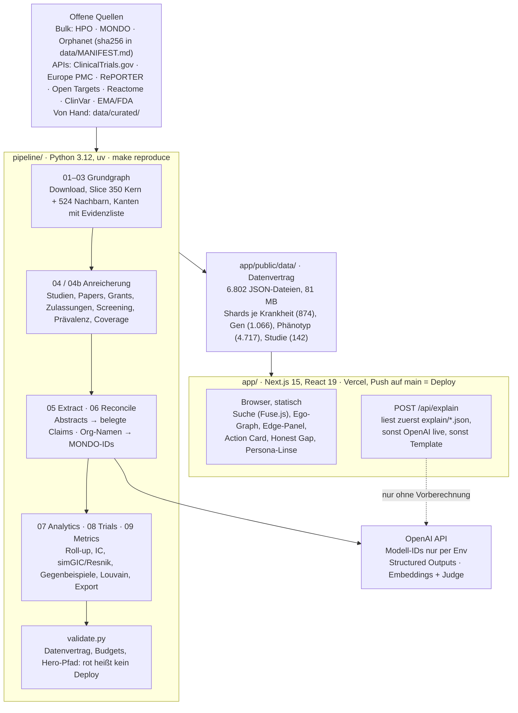

# Constellate · Technischer Setup-Report

Stand 04.10.2026 (Repo-Commit `821721d`, Export `2026-10-04+917470a`). Lebende Fassung zum Kommentieren: [Claude Doc](https://claude.ai/code/artifact/7756b466-b99b-4c44-adfa-c8fdb7e94ba2).

## Kurzfassung

Constellate ist eine **Offline-Pipeline in Python**, die aus offenen Biomedizin-Quellen einen evidenzgraduierten Wissensgraphen baut und ihn als **statische JSON-Shards** exportiert; eine **Next.js-App auf Vercel** zeigt ihn an (live: [constellate-vert.vercel.app](https://constellate-vert.vercel.app), jeder Push auf `main` deployt). Es gibt keine Datenbank und keinen Backend-Server außer einer einzigen Serverless-Route (`/api/explain`).

| Baustein | Technik | Warum so |
| --- | --- | --- |
| Pipeline | Python 3.12, uv, 10 Stufen (`01_fetch` bis `09_metrics`), Makefile | Reproduzierbar aus Rohquellen, alle schwere Rechenarbeit offline |
| Datenvertrag | `app/public/data/`: 6.802 Dateien, 81 MB | Seite lädt nur, was sie braucht; nichts kann zur Demo abstürzen |
| App | Next.js 15, React 19, TypeScript, Tailwind 4, react-force-graph-2d, Fuse.js | Schnell gebaut, statisch auslieferbar, gratis auf Vercel |
| KI | OpenAI an genau 3 Stellen: Extract, Reconcile, Explain | Pflicht für den Track-Preis, überall als KI markiert |
| Qualität | `validate.py`, 76 pytest-Tests, Playwright-E2E, tsc, ESLint | Datenvertrag und Hero-Pfad brechen nicht unbemerkt |
| Team | Git (ein Branch je Agent), Teamboard + `tools/board.py`, Skill `/constellate` | Osman und Recep arbeiten ohne Code-Zugriff mit |

Stand des Exports: `meta.json` Version `2026-10-04+917470a`, gebaut am 03.10.2026 23:15 UTC. Alle Zahlen in diesem Report stammen aus Repo-Dateien (vor allem `meta.json`, `Makefile`, `pyproject.toml`, `package.json`, `docs/`).

## Architektur auf einen Blick

Die Pipeline läuft lokal und schreibt nur nach `app/public/data/`; die App liest nur von dort. OpenAI arbeitet zweimal in der Pipeline und einmal in `/api/explain`, das zuerst vorberechnete Antworten ausliefert. Warum kein Neo4j oder anderer DB-Server: 874 Krankheiten passen als Shards ins CDN, die Analytik läuft offline, und ohne Server kann zur Demo nichts abstürzen.

## Pipeline (`pipeline/`, Python)

Die Pipeline baut den kompletten Datensatz deterministisch aus den Rohquellen; `make reproduce` läuft alle Stufen in Reihe. Jede Stufe schreibt Zwischenstände nach `data/` (gitignored), nur das Endprodukt landet in `app/public/data/` und wird committed.

### Laufzeit und Bibliotheken

| Werkzeug | Wofür | Warum |
| --- | --- | --- |
| Python 3.12 + **uv** (`pyproject.toml`, `uv.lock`) | Umgebung und Abhängigkeiten | uv installiert in Sekunden, Lockfile macht Builds gleich auf jedem Rechner |
| `httpx` | Alle HTTP-Abrufe (APIs, Downloads) | Timeouts, Retries, sauberer Client |
| `pandas`, `numpy`, `scipy` | Tabellen, Matrizen, Statistik (Spearman für die Monarch-Prüfung) | Standard, schnell genug für 874 × 12.865 Krankheiten |
| `networkx` | Graph, Louvain-Clustering | Louvain ist eingebaut, fester Seed möglich |
| `lxml` | Orphanet-XML parsen | Schnell bei 15-MB-XML |
| `pydantic` | Schemas für OpenAI Structured Outputs | Antwort des Modells wird typgeprüft |
| `openai` | Extract, Reconcile | Offizielles SDK |
| `rapidfuzz` | Fuzzy-Match als Reconcile-Fallback ohne Key | Läuft auch ohne OpenAI |
| `openpyxl` | EMA-Arzneimittelliste (xlsx) | EMA liefert nur Excel |
| `pyyaml`, `python-dotenv`, `tqdm` | Kuratierte YAML, `.env.local` laden, Fortschritt | Kleinkram |
| `pytest` (dev) | 76 Testfunktionen in `pipeline/tests/` | OpenAI-Schritte mit Mock testbar, ohne Key |

### Die Stufen

| Make | Skript | Was passiert | Ergebnis |
| --- | --- | --- | --- |
| `fetch` | `01_fetch.py` | Lädt HPO, MONDO, Orphanet; idempotent (überspringt Dateien mit passender Größe); sha256 je Datei | `data/raw/`, `data/MANIFEST.md` |
| `slice` | `02_slice.py` | MONDO-Teilbaum „lysosomal storage disease" (MONDO:0002561) plus Leukodystrophie (MONDO:0019046) als Kern, dazu Nachbarn über gemeinsame Gene oder informative Phänotypen | `data/slice.json`: 350 Kern + 524 Nachbarn |
| `build` | `03_build_graph.py` | Knoten (MONDO, HGNC, HPO) und Kanten `caused_by`, `has_phenotype` mit Evidenzliste; Kanten-IDs stabil als `e_<12 hex>` | `data/graph_base.json` (26 MB) |
| `enrich` | `04_enrich_apis.py` + `pipeline/enrich/` | ClinicalTrials.gov, Europe PMC, NIH RePORTER, Open Targets, Reactome, ClinVar, mygene; Rohantworten im Cache, Coverage-Datensatz je Krankheit × Quelle | 1.055 Studien, 1.855 Papers, 1.687 Grants (laut `STATUS.md`) |
| `enrich-extra` | `04b_enrich_extra.py` + `pipeline/enrich_extra/` | data-v2: Natural-History-Studien und Register, Neugeborenen-Screening, EMA/FDA-Zulassungen, Prävalenz, Forschernetz, Monarch-Abgleich, Coverage-Audit; respektiert robots.txt, läuft mit `--offline` aus dem Cache | Felder für die Action Card v2 |
| `extract` | `05_openai_extract.py` | OpenAI: Abstracts → Claims mit harten Verankerungs-Checks | `text_mined`-Kanten |
| `reconcile` | `06_openai_reconcile.py` | OpenAI: Org-Namen → MONDO-IDs, nur verifizierte Orgs | `advocated_by`-Kanten |
| `analytics` | `07_analytics.py` (1.850 Zeilen, Herzstück) | Roll-up, IC, simGIC/Resnik, Gegenbeispiele, Louvain, Merge aller Quellen, Export mit Größenbudget | `app/public/data/` |
| `trials` | `08_trial_details.py` | Länder, Zentren, Einschlusskriterien offener Studien; **keine** Namen, Mails oder Telefonnummern von Studienpersonal | 142 Dateien in `trial/` |
| `metrics` | `09_metrics.py` | Qualitätszahlen für die Jury in `meta.metrics` | Monarch ρ, Coverage, Hero-Regression |
| `validate` | `validate.py` | Prüft Export gegen den Datenvertrag, Exit 1 bei Fehler | grün = darf deployt werden |

**Warum diese Bauweise:** Rohdaten werden einmal geladen und gecacht, jede Stufe ist einzeln wiederholbar, und ein zweiter Lauf trifft nur den Cache. Fehlt eine optionale Eingabe (z. B. kein OpenAI-Output), überspringt 07 sie sauber, statt abzubrechen. Determinismus (sortierte Iteration, fester Seed 42, single-threaded BLAS, gerundete Floats) sorgt dafür, dass derselbe Input denselben Export ergibt und Diffs im Git lesbar bleiben.

## Datenquellen und APIs

`meta.json` listet 19 Quellen, alle offen und ohne Pflicht-Key. Grundsatz: nur Quellen mit klarer Lizenz und Primärbeleg, kein Scraping von Websites ohne Erlaubnis. Details und getestete Endpunkte: [DATA-SOURCES.md](DATA-SOURCES.md).

### Bulk-Downloads (Grundgerüst des Graphen)

| Quelle | Version | Liefert | Lizenz | Warum |
| --- | --- | --- | --- | --- |
| HPO (`phenotype.hpoa`, `genes_to_phenotype.txt`, `hp.json`) | 2026-09-02 | Krankheit → Phänotyp mit Frequenz, Ontologie für IC | frei mit Attribution | Goldstandard für Phänotypen, enthält OMIM-Daten indirekt |
| MONDO (`mondo.json`) | 2026-09-01 | Stabile Krankheits-IDs, Synonyme, xrefs, Hierarchie | CC-BY 4.0 | Vereinheitlicht OMIM, Orphanet, DOID; Basis für Slice und Roll-up |
| Orphanet (product 1, 4, 6, 9) | JDBOR 2026-06-23 | Krankheiten, Phänotypen, Gene, Prävalenz | CC-BY 4.0 | Europäische Referenz für seltene Krankheiten |
| OMIM | über HPO | nur indirekt | Attribution OMIM | Direkter Zugang braucht Tage für die Freigabe |

### APIs (Anreicherung, alle ohne Key)

| Quelle | Liefert | Lizenz |
| --- | --- | --- |
| ClinicalTrials.gov API v2 | Studien, Beobachtungsstudien (Register, Natural History), Standorte | US Public Domain |
| Europe PMC REST | Papers, Abstracts, Autoren mit ORCID | Metadaten CC0, Abstracts nur als Snippet |
| NIH RePORTER v2 | Förderungen, PIs | US Public Domain |
| Open Targets GraphQL | Gen-Krankheit-Scores je Datentyp | CC0 |
| Reactome ContentService | Gen → Pathways | CC0 |
| ClinVar (E-utilities) | Pathogene Varianten je Gen | US Public Domain |
| mygene.info | Symbol → UniProt (Brücke zu Reactome) | frei |
| EMA Medicine Data (xlsx) | EU-Zulassungen | © EMA, mit Quellenangabe |
| openFDA, Drugs@FDA, FDA-CBER-Seiten | US-Zulassungen inkl. Gentherapien | US Public Domain / CC0 |
| Offizielle NBS-Seiten (AT, NO, IT-52, US-MN, US-NY) | Neugeborenen-Screening-Status | amtlich, nur kurzes wörtliches Zitat mit Link |
| Monarch API v3 semsim | Nur Validierung unserer Ähnlichkeit, keine Kanten | CC-BY 4.0 |

### Handkuratiert (`data/curated/`)

- `orgs.csv` (Osman): Patientenorganisationen, nur von Hand geprüfte Zeilen mit `verified_date`. Stand des Reports: nur Kopfzeile; Entwurf `orgs_draft.csv` hat 40 Orgs. Warum von Hand: Orphanet gibt Org-Daten nicht frei, NORD und Global Genes haben keine API, Scraping ist rechtlich grau.
- `hero_path.yaml` (Recep): belegte Aussagen für den Hero-Pfad; Entwurf mit 66 Einträgen.
- `assets.csv`: 471 Zeilen Assets (Register, Natural-History-Studien) aus 04b.

**Nachvollziehbarkeit:** Jeder Bulk-Download steht mit URL, Datum und sha256 in `data/MANIFEST.md`. API-Antworten liegen im Cache unter `data/cache/`, sodass ein zweiter Lauf offline geht. Was nicht erreichbar war (z. B. HRSA mit 403), steht als `UNBELEGT` im Datensatz statt geraten.

## OpenAI-Einsatz

OpenAI arbeitet an genau drei Stellen im Produkt, weil der Brief Track-Preise nur für „Built with OpenAI" vergibt. Entwickelt wird mit Claude (erlaubt), aber die KI im Produkt ist OpenAI. Jede Stelle hat einen Fallback ohne Key, damit die App nie wegen eines fehlenden Keys bricht.

| Stelle | Wo | Modell (Env-Variable) | Technik | Fallback ohne Key |
| --- | --- | --- | --- | --- |
| **Extract** | Pipeline, `05_openai_extract.py` | `OPENAI_MODEL_EXTRACT` | Structured Outputs (Pydantic-Schema): Abstract → Claims (Subjekt, Prädikat, Objekt, Snippet, PMID) | Baut aus dem Cache neu oder endet sauber mit Hinweis |
| **Reconcile** | Pipeline, `06_openai_reconcile.py` | `OPENAI_MODEL_EMBED` + `OPENAI_MODEL_JUDGE` | Embeddings → Top-5 MONDO-Kandidaten per Cosinus, dann Judge wählt einen oder „none" (Schema erlaubt nur diese IDs) | rapidfuzz `token_sort_ratio`, Kante dann `inferred` statt `text_mined` |
| **Explain** | App, `POST /api/explain` | `OPENAI_MODEL_EXPLAIN` | Kanten der Action Card → Klartext, gestreamt; jeder Satz muss mit `[e_…]` auf eine echte Kante zeigen | Template-Text, sichtbar als „template, no LLM" markiert |

### Warum so streng

Die Extract-Checks sind hart, die Selbsteinschätzung des Modells zählt nichts. Ein Claim kommt nur durch, wenn alle vier Prüfungen bestehen:

1. Das Snippet steht wörtlich im Abstract (20 bis 500 Zeichen).
2. Die PMID ist die des gesendeten Abstracts.
3. Subjekt und Objekt sind Knoten im Graphen und werden im Titel oder Abstract genannt.
4. Das Prädikat stammt aus einem geschlossenen Vokabular und passt zu den Knotentypen.

Die Konfidenz ist auf 0,7 gedeckelt, „contradicts" landet als Gegenevidenz. Abgelehnte Claims werden mit Grund in `rejected.jsonl` gespeichert. So kann das Modell keine Kante erfinden, die nicht im Text steht.

Bei Explain wird jeder Satz nach der Generierung geprüft: Sätze ohne gültige Kanten-ID werden verworfen und durchgestrichen angezeigt. Das ist die Antwort auf „KI halluziniert".

### Konfiguration

- Modell-IDs **nur** aus Umgebungsvariablen, kein Default im Code (`pipeline/openai_config.py`). Begründung: eine geratene Modell-ID führt still zum falschen Modell. `python pipeline/openai_config.py --list` zeigt, welche Modelle der Key wirklich kann.
- Optional: `OPENAI_REASONING_*` (Reasoning-Effort), `OPENAI_PRICE_*` (Kostenschätzung), Retries bei 408/409/429/5xx.
- Antworten werden je Modell und Prompt-Version gecacht (`data/cache/openai/`). Ein zweiter Lauf kostet nichts, und ein Prompt-Wechsel invalidiert den Cache automatisch.
- Prompts liegen versioniert in `pipeline/prompts/` (`extract.md`, `reconcile.md`) und `app/lib/prompts/explain.ts`.

### Explain vorberechnet

`make explain` (`app/scripts/precompute-explain.ts`) erzeugt die Antworten für den Hero-Pfad und die ersten 50 Kernkrankheiten vorab als JSON unter `public/data/explain/<key>.json` (Key = sha1 der sortierten Kanten-IDs). Die Live-Route liefert zuerst diese Datei aus, prüft die Zitate erneut und ruft OpenAI nur ohne Datei auf. **Warum:** Die Webseite braucht dann keinen Key, es entstehen keine Kosten durch Besucher, und die Demo hängt nicht an der OpenAI-Verfügbarkeit.

**Stand:** Laut `STATUS.md` fehlt der `OPENAI_API_KEY` lokal (HackOS hat keine OpenAI-Credits). In `app/public/data/` gibt es noch keinen `explain/`-Ordner, und `meta.metrics.extract_precision` ist `null`. Extract, Reconcile mit OpenAI und Explain sind gebaut und mit Mocks getestet, aber noch nicht mit echtem Key gelaufen.

## Datenmodell und Datenvertrag

Der Datenvertrag ist die einzige Schnittstelle zwischen Pipeline und App: Die Pipeline schreibt nach `app/public/data/`, die App liest nur von dort und schreibt nie. Maßgeblich ist [app/README.md](../app/README.md); eine Änderung geht nur zusammen mit `pipeline/validate.py` und `app/lib/normalize.ts`.

### Dateien

| Datei / Ordner | Anzahl | Größe | Inhalt |
| --- | --- | --- | --- |
| `meta.json` | 1 | 7,8 KB | Version, Quellen mit Lizenz, Zähler, Parameter, Qualitätsmetriken |
| `index.json` | 1 | 1,23 MB | Suchindex: ID, Typ, Label, Synonyme, xrefs |
| `core.json` | 1 | 1,69 MB | Kernkrankheiten mit Clustern, Startgraph |
| `disease/` | 874 | 35 MB | Ein Shard je Krankheit mit allen Kanten und Action-Card-Feldern |
| `gene/` | 1.066 | 4,9 MB | Ein Shard je Gen |
| `phenotype/` | 4.717 | 38 MB | Ein Shard je Phänotyp im Index |
| `trial/` | 142 | 624 KB | Standorte und Einschlusskriterien offener Studien |

**Warum Shards statt einer großen Datei oder Datenbank:** Eine Seite lädt `index.json`, `core.json` und die zwei, drei Shards, die sie braucht. Der Median-Shard hat 2,2 KB, der größte 149 KB. Vercel liefert alles als statische Dateien aus dem CDN, es gibt nichts, das unter Last abstürzen kann.

**Budgets** (vom Validator erzwungen): `core.json` + `index.json` unter 3 MB (heute 2,92 MB), jeder Shard unter 150 KB (größter heute 149,1 KB). Beide liegen knapp an der Grenze.

### Knoten und Kanten

Knoten: 874 Krankheiten (350 Kern), 1.066 Gene, 5.642 Phänotypen (4.717 im Suchindex), dazu Orgs (`ORG:<slug>`, sobald `orgs.csv` gefüllt ist).

Jede Kante hat:

- `id` = `e_<12 hex>`, stabil aus Quelle, Ziel und Typ abgeleitet
- `evidence[]` mit `db`, `origin`, `record`, `url`, `level`, `date`, `confidence`, `snippet`
- `contradicting[]` (Pflichtfeld, darf leer sein)
- `confidence`, `level`, `independent_sources`
- bei `inferred` zusätzlich `formula` mit Inputs, bei Roll-up `rolled_up_from`

| Kantentyp | Anzahl |
| --- | --- |
| `has_phenotype` | 42.204 |
| `similar_phenotype` | 1.965 |
| `caused_by` | 1.465 |
| `shares_gene` | 388 |
| `associated_gene` | 225 |

### Evidenzstufen

| Stufe | Bedeutung | Anzahl Kanten | Darstellung im Graphen |
| --- | --- | --- | --- |
| `curated` | Experten-Datenbank (Orphanet, MONDO, Reactome) | 27.066 | durchgezogen |
| `observed` | Beobachtet mit Primärquelle (HPO mit Frequenz, ClinVar, Studie) | 14.512 | durchgezogen |
| `inferred` | Von uns berechnet, Formel in `formula` | 4.181 | gepunktet |
| `contradicted` | Gegenevidenz überwiegt | 488 | rot |
| `text_mined` | Von OpenAI aus Abstract, mit PMID und Snippet | 0 (Extract noch nicht gelaufen) | gestrichelt |

**Warum diese Stufen:** Der Brief verlangt, Beobachtungen von abgeleiteten Verbindungen zu trennen. Jede Kante sagt, woher sie kommt und wie sicher sie ist; Gegenevidenz ist nie versteckt. Beispiel aus dem Evidenzmodell-Fix: 531 Einträge „0 von n Patienten" sind jetzt Gegenevidenz, 217 `caused_by` wurden zu `associated_gene` herabgestuft.

## Analytik (`07_analytics.py`)

Die Analytik läuft komplett offline, damit die App nur noch nachschlagen muss. Alle Parameter stehen in `meta.json` unter `parameters`, damit die Jury jede Zahl nachrechnen kann.

| Verfahren | Was es tut | Parameter / Ergebnis | Warum |
| --- | --- | --- | --- |
| Subtyp-Roll-up | Elternkrankheit erbt Gen- und Phänotyp-Kanten ihrer MONDO-Subtypen, markiert mit `rolled_up_from` | Konfidenz × 0,5, max. 15 Gene; 1.828 Kanten (194 `caused_by`, 10 `associated_gene`, 1.624 `has_phenotype`) | Patienten suchen oft die Familie („MLD"), die Daten hängen am Subtyp |
| Information Content (IC) | Wie selten ein HPO-Term über alle annotierten Krankheiten ist | 12.724 Terme, Korpus 12.865 Krankheiten | Seltene gemeinsame Symptome sagen mehr als „Krampfanfälle" |
| simGIC (Pesquita 2008) | Phänotyp-Ähnlichkeit Kern × alle | Top 10 je Kernkrankheit als `similar_phenotype`, Top-25 Phänotypen | Standardmaß, schnell für alle Paare |
| Resnik-BMA | Zweites Ähnlichkeitsmaß für die Top 20 | Cross-Check von simGIC | Robustheit gegen Ausreißer |
| `shares_gene` | Krankheiten mit demselben ursächlichen Gen | 388 Kanten | Mechanistische Verwandtschaft |
| Gegenbeispiele | Ähnlicher Phänotyp, aber anderer Mechanismus (`mechanism_differs`), nur aus kuratierten MONDO-Klassen | 9 Mechanismusklassen, simGIC ≥ 0,15, Rang ≤ 20; 251 Paare | Zeigt Grenzen: Krabbe ↔ Pelizaeus-Merzbacher sieht ähnlich aus, ist es mechanistisch nicht |
| Louvain-Clustering | Communities auf simGIC + 0,3 × gemeinsame Gene | Seed 42, Auflösung 1,0; 17 Cluster, Modularität 0,678 | Findet „Familien", deren Namen den Mechanismus verstecken |
| Coverage / Honest Gap | Je Krankheit: was gesucht wurde, wie viele Treffer, was fehlt | Studien 126/350, Papers 233/350, Assets 114/350 Kernkrankheiten | Zeigt Lücken statt zu raten |

### Validierung gegen Dritte (`09_metrics.py`)

| Metrik | Wert | Quelle |
| --- | --- | --- |
| Spearman ρ simGIC vs. Monarch semsim (HPO-Profile) | 0,661 (n = 49, p = 2,4 × 10⁻⁷) | Monarch API v3, 03.10.2026 |
| Spearman ρ Krankheit–Krankheit (nur MONDO-Klassen) | 0,326 (n = 50, p = 0,021) | Monarch `compare/<MONDO>/<MONDO>` |
| Hero-Regression | 12 von 12 Checks bestanden | 04.10.2026 |
| Extract-Präzision | ausstehend (`null`) | braucht Handprüfung nach dem Extract-Lauf |
| Reconcile-Genauigkeit | ausstehend (`null`) | braucht verifizierte `orgs.csv` |

**Warum das wichtig ist:** Die Ähnlichkeit ist nicht nur eine eigene Formel, sondern gegen eine unabhängige Quelle geprüft. `/methods` in der App zeigt diese Zahlen und schreibt „pending", wo ein Wert noch fehlt.

## App (`app/`, Next.js)

Die App ist eine fast rein statische Next.js-Seite, die die JSON-Shards im Browser lädt; die einzige Server-Logik ist `/api/explain`.

### Stack

| Werkzeug | Version | Wofür | Warum |
| --- | --- | --- | --- |
| Next.js (App Router) | ^15.5 | Routing, Build, Serverless-Route | Auf Vercel ohne Konfiguration deploybar, statisch + eine API-Route in einem Projekt |
| React | ^19.3 | UI | Standard, blockt `javascript:`-URLs von Haus aus |
| TypeScript | ~5.9 | Typen für den Datenvertrag (`lib/types.ts`) | Vertragsänderungen fallen beim Build auf |
| Tailwind CSS | ^4.3 | Styling, Dark Mode | Schnell, keine eigene CSS-Architektur nötig |
| react-force-graph-2d | ^1.29 | Ego-Graph als Canvas | Kraftlayout ohne WebGL, läuft auf jedem Laptop und Handy |
| Fuse.js | ^7.5 | Fuzzy-Suche über `index.json` | Clientseitig, kein Suchserver, findet auch Tippfehler und Synonyme |
| Playwright | ^1.63 | E2E-Test des Hero-Pfads | Testet echtes Klicken bei 1280 und 375 px |
| ESLint, tsx | ^9.39, ^4.23 | Lint, Skripte (Explain-Vorberechnung) | Standard |

Node ≥ 20 ist Pflicht (`engines`).

### Seiten

| Route | Inhalt |
| --- | --- |
| `/` | Startseite mit einer Suche für alles (Krankheit, Gen, Symptom, ORPHA/OMIM-ID) |
| `/d/[id]` | Krankheitsseite: Ego-Graph, Edge-Panel, offene Studien mit Länderfilter, Honest Gap, Literatur |
| `/d/[id]/action` | Action Card v2: verwandte Community, Assets (Register, Natural History), Zulassungen, Neugeborenen-Screening, Forscher-Überschneidung, Prävalenz, Explain, Export |
| `/g/[symbol]` | Gen-Seite |
| `/p/[id]` | Phänotyp-Seite |
| `/o/[slug]` | Patientenorganisation (mit Draft-Badge, solange unverifiziert) |
| `/methods` | Methoden, Formeln, Qualitätsmetriken |
| `/about` | Projekt, Quellen, Lizenzen |
| `POST /api/explain` | Klartext-Erklärung der Action Card, gestreamt |

### Wichtige Bausteine

- **Ego-Graph** (`EgoGraph.tsx`, `ForceGraphClient.tsx`): nur per dynamischem Import im Client geladen. Knotenfarbe = Typ, Linienstil = Evidenzstufe, rot = Gegenevidenz, Subtypen zu Familienknoten gebündelt.
- **Edge-Panel** (`EdgePanel.tsx`): Quelle, Typ, Konfidenz, Snippet, Link zur Primärquelle; der Gegenevidenz-Slot ist immer sichtbar, auch wenn er leer ist.
- **Honest Gap** (`HonestGap.tsx`): was gesucht wurde, was fehlt, welche Frage als Nächstes zu testen ist.
- **Persona-Linse** (`lib/persona.ts`): fünf Personas (family, nora, devon, priya, osei) ändern Ranking, Reihenfolge und Wortwahl, nie die Daten.
- **Datenzugriff** (`lib/data.ts`): ein `fetch` je Datei mit In-Memory-Cache; 404 ist ein Zustand, kein Fehler (z. B. fehlender Trial-Shard). `NEXT_PUBLIC_DATA_BASE` kann die Daten von einem anderen Origin laden (Test/CDN).
- **Normalisierung** (`lib/normalize.ts`): Spiegelbild von `validate.py` auf App-Seite.
- **Fixtures** (`app/fixtures/`): nur mit `NEXT_PUBLIC_USE_FIXTURES=1`, sonst nicht im Bundle.

**Warum statisch:** Keine Datenbank, kein Login, keine Nutzerdaten. Das ist für die Demo am stabilsten, kostet nichts im Betrieb und ist aus Datenschutzsicht trivial.

## Build, Deployment und Umgebungen

Die App läuft auf **Vercel** unter [constellate-vert.vercel.app](https://constellate-vert.vercel.app), Projekt-Root `app/`; jeder Push auf `main` löst ein Deployment aus. Die Daten fahren mit, weil `app/public/data/` committed ist.

| Umgebung | Was dort läuft | Warum |
| --- | --- | --- |
| Hannos Mac (lokal) | Volle Pipeline inkl. Abrufe, OpenAI-Läufe, Orchestrator- und Data-Steward-Sessions | Hat die Keys in `.env.local`, ClinicalTrials.gov ist erreichbar |
| Cloud-Sessions (Claude Code im Web) | Code, Doku, Reviews auf eigenen Branches | Parallel arbeiten; ClinicalTrials.gov ist dort gesperrt, darum laufen `make trials` und Teile von 04 lokal |
| GitHub `hannokuegler/constellate` | Quelle der Wahrheit, ab So 11:00 public | Alles Abzugebende liegt im Repo |
| Vercel | Produktion | Gratis, CDN, Serverless für `/api/explain` |
| Teamboard | Status, Aufgaben, Datei-Ablage für Osman und Recep | Separater, temporärer Dienst bis 11.10.2026, Login im Team-Chat |

### Wie ein neuer Datenstand live geht

1. Lokal `make <stufe>` bis `make analytics` (oder `make reproduce` für alles).
2. `make validate` muss grün sein, dazu `npm run typecheck`, `npm run lint`, `npm run e2e`.
3. Commit mit Präfix `data:` und Push auf `main`.
4. Vercel baut und deployt automatisch.

### Caching und Header

- `/data/*` wird mit `Cache-Control: public, max-age=300, stale-while-revalidate=3600` ausgeliefert. Warum: Die Pipeline kann jederzeit neu exportieren, nach fünf Minuten sehen alle Besucher den neuen Stand.
- Alle Seiten bekommen Security-Header aus `app/next.config.ts` (Details im Abschnitt Sicherheit).
- `/api/explain` läuft als Node-Serverless-Funktion (`runtime = "nodejs"`, `force-dynamic`).

### Umgebungsvariablen

| Variable | Wo | Pflicht |
| --- | --- | --- |
| `OPENAI_API_KEY` | Pipeline (05, 06), App (`/api/explain`, nur ohne Vorberechnung) | für den Track-Preis ja, für den Betrieb nein |
| `OPENAI_MODEL_EXTRACT`, `_JUDGE`, `_EMBED`, `_EXPLAIN` | Pipeline / App | ja, wenn der Key gesetzt ist |
| `OPENAI_BASE_URL`, `OPENAI_MAX_OUTPUT_EXPLAIN`, `EXPLAIN_RATE_PER_MIN`, `EXPLAIN_LLM_PER_HOUR`, `EXPLAIN_PRECOMPUTED` | App | nein (Defaults 4.000 Tokens, 10/min, 200/h) |
| `NCBI_API_KEY` | Pipeline | nein, hebt das Limit von 3 auf 10 Anfragen/s |
| `BRIGHTDATA_API_KEY`, `BRIGHTDATA_ZONE` | Pipeline (04b) | nein, für Seiten, die Bots blocken; nicht gesetzt |
| `ELEVENLABS_API_KEY` | Videos (Voice-over) | nein |
| `NEXT_PUBLIC_DATA_BASE`, `NEXT_PUBLIC_USE_FIXTURES` | App, Dev/Test | nein |
| `TEAMBOARD_URL`, `_USER`, `_PASS`, `_WHO` | `tools/board.py` | für das Board ja |

Vorlage: `.env.example`. Echte Werte nur in `.env.local` (Root) und `app/.env.local`, beide gitignored.

## Dev-Tooling, Tests und Teamarbeit

### Make als einziger Einstieg

Das `Makefile` bündelt alles: `make setup` (uv sync + npm install), je ein Ziel pro Pipeline-Stufe, `make validate`, `make reproduce`, `make dev`, `make explain`. **Warum:** Jeder (auch Osman beim Reproduce-Test) braucht nur einen Befehl und muss die Skriptnamen nicht kennen.

### Qualitäts-Gates

| Gate | Befehl | Prüft |
| --- | --- | --- |
| Datenvertrag | `make validate` | Evidenz an jeder Kante, `contradicting` vorhanden, IDs eindeutig, Endpunkte existieren, `formula` bei `inferred`, Budgets, Index ↔ Shards, Hero-Pfad komplett (Krabbe → GALC, PSAP → MLD, MLD → ARSA, Krabbe ↔ PMD mit `mechanism_differs`) |
| Pipeline-Unit-Tests | `uv run pytest` in `pipeline/` | 76 Testfunktionen: OpenAI-Schritte mit Mock (35), data-v2-Integration (22), 04b (17), Trials (2) |
| Typen | `npm run typecheck` | `tsc --noEmit` über die ganze App |
| Lint | `npm run lint` | ESLint mit Next-Config |
| E2E | `npm run e2e` | Playwright: Hero-Pfad bei 1280 und 375 px, Dark Mode, keine Console-Errors, keine 4xx/5xx (außer optionalen Trial-Shards), Screenshots |
| Metriken | `make metrics` | Hero-Regression (12 Checks), Monarch-Abgleich |

Es gibt **keine CI** (kein `.github/workflows/`). Die Gates laufen von Hand vor jedem Push auf `main`. Bei einem 30-Stunden-Hackathon spart das Einrichtungszeit, heißt aber: Wer die Gates vergisst, merkt den Fehler erst live.

### Git-Workflow

- Ein Branch je Agent oder Aufgabe, `main` = live (Entscheidung P8). Sammel-Branch `integrate` für den Orchestrator.
- Commit-Präfixe `pipeline:`, `app:`, `data:`, `docs:`, ein Satz. Vor dem Push `git pull --rebase`, nie `--force`, nie `git add .`.
- Zuständigkeit: `pipeline/` und `app/` nur Hanno bzw. beauftragte Agents; Osman und Recep nur `data/curated/`, `BUGS.md`, README, `docs/MOONSHOT.md`.
- Bugs in `BUGS.md` im Format `[P1|P2|P3] Screen · Schritte · erwartet · gesehen · (wer)`.

### Teamboard und Agenten-Orchestrierung

| Werkzeug | Was | Warum |
| --- | --- | --- |
| Teamboard ([TEAMBOARD.md](TEAMBOARD.md)) | Countdown, Status, Aufgaben O1–O6 / R1–R5 / H1–H9, Entscheidungen, Datei-Ablage, Bugs | Osman und Recep können ohne Git mitarbeiten |
| `tools/board.py` | CLI fürs Board, nur Standardbibliothek, Basic Auth aus Env, eigener User-Agent (Cloudflare blockte sonst mit 403) | Agents können das Board per Skript pflegen |
| Skill `/constellate` (`.claude/skills/constellate/`) | Zieht Lage aus Repo und Board, setzt Status-Karte und `docs/STATUS.md` | Board und Repo bleiben im Gleichschritt |
| Prompts in `docs/prompts/` (10 Dateien) | Dauer- und Übergabe-Prompts für Orchestrator, Data Steward, Data Chief, Design, Marketing | Jede neue Claude-Session startet mit vollem Kontext |
| `CLAUDE.md` | Landkarte und harte Regeln für jede Session | Einheitliches Verhalten aller Agents |

### Werkzeuge außerhalb des Codes

- **Claude Code**: Build-Werkzeug für Pipeline, App und Doku (lokal und in der Cloud).
- **ElevenLabs** (`eleven_v4`): Voice-over der Videos, Skripte in `pitch/VOICE-ELEVENLABS.md`.
- **Motion**: optional für Pitch-Opener, Prompts in `pitch/MOTION-PROMPTS.md`.
- **Bright Data**: geplant für Seiten, die Bots blocken; Zone fehlt, darum nicht genutzt.
- **Lovable**: nur optional für eine Story-Page, nie für die App.

## Sicherheit und Secrets

Das Security-Review vom 04.10.2026 ([SECURITY.md](SECURITY.md)) fand keine Secrets in der Git-History und hat die einzige angreifbare Stelle, `/api/explain`, abgesichert. Das Bedrohungsmodell ist klein: statische Seite, eine Serverless-Route, kein Login, keine Nutzerdaten.

| Bereich | Maßnahme | Warum |
| --- | --- | --- |
| Keys | Nur aus Umgebungsvariablen; `.gitignore` sperrt jede `.env.*` außer `.env.example`, dazu `*.pem`, `*.key` | Repo wird So 11:00 public, die History bleibt sichtbar |
| History-Scan | Alle Commits aller Branches per Skript auf Keys, Tokens, Passwörter, IPs, Serverpfade, Telefonnummern geprüft | Nichts gefunden, nur leere Vorlagen |
| `/api/explain` | Body max. 600 KB, max. 60 Kanten, Kanten-ID-Regex, `disease` muss MONDO-ID sein, Felder neu aufgebaut und gekürzt | Schutz vor Kostenmissbrauch und Prompt-Injection |
| Rate-Limit | 10 Anfragen/min je IP, 200 LLM-Aufrufe/h je Instanz, danach Template-Text; max. 4.000 Output-Tokens, 90 s Timeout | Begrenzt die Kosten, falls jemand die Route als Gratis-LLM nutzt |
| Fehlermeldungen | Upstream-Fehler werden von allem gereinigt, was wie ein Key aussieht | Kein Key-Leak über Fehler |
| Security-Header | CSP (`default-src 'self'`, `frame-ancestors 'none'`, `object-src 'none'`), `nosniff`, `X-Frame-Options: DENY`, Referrer- und Permissions-Policy, COOP | Schutz vor XSS, Clickjacking, Datenabfluss |
| XSS | Kein HTML/Markdown aus Daten gerendert, Explain-Text als Textknoten, alle Daten-URLs `https:`, externe Links `rel="noreferrer"` | Daten aus fremden Quellen können kein Skript einschleusen |
| Datenschutz | Keine Namen, Mails oder Telefonnummern von Studienpersonal; Forschernetz ohne Kontaktdaten; Telefon-Scrub in 04b | Personendaten gehören nicht ins Produkt |
| Teamboard | Login nur im Team-Chat, nie im Repo; Abbau am 11.10.2026 | URL ist öffentlich in Docs und History |

**Bekannte Restpunkte** (aus `SECURITY.md`, Hanno entscheidet):

- Zwei persönliche Mail-Adressen stehen als Commit-Autoren in der History und werden mit dem Repo öffentlich. Eine Änderung bräuchte ein History-Rewrite (nicht empfohlen).
- `script-src` erlaubt `'unsafe-inline'`, weil Next.js Inline-Skripte einfügt; Nonce-basierte CSP bräuchte Middleware.
- `postcss` in Next 15 hat eine Advisory (nur Build-Zeit, nicht von Besuchern erreichbar); Fix braucht Next 16.
- Das Rate-Limit ist pro Instanz und im Speicher, also nur „best effort". Für echten Schutz: Budget-Limit im OpenAI-Dashboard, eigener Key für Vercel, Keys nach dem Hackathon rotieren.
- Lizenz: MIT gilt für den Code; die Daten behalten die Lizenzen ihrer Quellen. Ein Satz dazu in README oder LICENSE fehlt noch.

## Stärken, Risiken und offene Punkte

Das Setup ist für eine Demo sehr robust (statisch, validiert, reproduzierbar). Die größte Lücke ist OpenAI: Ohne Key gibt es keinen Anspruch auf den Track-Preis.

### Stärken

- **Evidenz an jeder Kante**, Gegenevidenz-Slot immer da, fünf klar getrennte Stufen. Das trifft den Kern des Briefs.
- **Reproduzierbar**: `make reproduce` aus Rohquellen, Manifest mit sha256, fester Seed, Caches.
- **Ausfallsicher**: keine Datenbank, kein Backend außer einer Route mit Fallback; Explain vorberechenbar.
- **Gegen Dritte geprüft**: Monarch ρ = 0,661, Hero-Regression 12/12.
- **Ehrlich**: Honest Gap und `UNBELEGT` statt Raten; KI-Ausgaben hart an Primärquellen gebunden.

### Risiken und offene Punkte

| Punkt | Folge | Vorschlag |
| --- | --- | --- |
| `OPENAI_API_KEY` fehlt | Extract, Reconcile (OpenAI-Pfad) und Explain nie echt gelaufen; 0 `text_mined`-Kanten, kein `explain/`-Ordner | Key holen, `python pipeline/openai_config.py --list`, dann `make extract reconcile analytics explain validate` |
| `orgs.csv` und `hero_path.yaml` leer bzw. nur Gerüst | Keine Patientenorgs im Produkt, `reconcile_accuracy` = `null` | Osman/Recep prüfen und übernehmen, dann `make reconcile analytics` |
| Budgets knapp | `core` + `index` = 2,92 von 3 MB, größter Shard 149,1 von 150 KB; jede neue Kante kann `validate` rot machen | Vor einem Re-Export mit mehr Daten Caps prüfen (`parameters.v2`) |
| Keine CI | Fehler fallen erst live auf, wenn jemand die Gates vergisst | Gates vor jedem Push auf `main` von Hand; nach dem Hackathon GitHub Actions |
| ClinicalTrials.gov in der Cloud gesperrt | `make trials` und Teile von 04/04b nur lokal | Datenläufe bleiben auf Hannos Mac |
| Veraltete Doku | `STATUS.md` nannte Vercel als Blocker, obwohl die App live ist; `RESOURCES.md` erwähnt `/api/resolve` und `pipeline/config.py`, die es nicht gibt | Beim nächsten `/constellate`-Lauf nachziehen |
| Bright Data ohne Zone | US-Neugeborenen-Screening (HRSA, 403) bleibt `UNBELEGT` | Akzeptieren, als Honest Gap zeigen |
| Rate-Limit nur im Speicher | Bei vielen Instanzen kein harter Kostendeckel | Budget-Limit im OpenAI-Dashboard setzen |

### Quellen dieses Reports

Alle Angaben aus dem Repo `hannokuegler/constellate`, Stand Commit `821721d` (04.10.2026, 01:27): `app/public/data/meta.json`, `Makefile`, `pipeline/pyproject.toml`, `app/package.json`, `app/next.config.ts`, `.env.example`, `.gitignore`, Docstrings der Pipeline-Skripte, `docs/ARCHITECTURE.md`, `docs/STATUS.md`, `docs/SECURITY.md`, `docs/DATA-SOURCES.md`, `docs/RESOURCES.md`, `docs/TEAMBOARD.md`, `app/README.md`.
