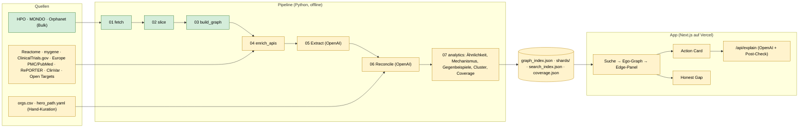

**Hinweis, Stand Sa 03.10. 21:00 (Kopie aus dem Team-Briefing, Fragenkatalog inklusive).** Seither ist im Code und in den Daten gefixt, was unten noch als offen oder falsch steht. Aktuelle Zahlen und Stand: [STATUS.md](../STATUS.md), offene und vorläufig entschiedene Fragen: [DECISIONS.md](../DECISIONS.md).

Seither gefixt:

- Determinismus: Slice mit Tie-Break auf die ID, Edge-IDs als stabiler Hash mit 12 Hex-Zeichen (`e_<12 hex>`, vorher 8), Provenienz je Beleg ehrlich (`origin` je Evidenz, `independent_sources` je Kante).
- Die 531 Einträge „0 von n Patienten" sind jetzt Gegenevidenz (`contradicting`), nicht mehr positive `has_phenotype`-Belege.
- 217 überbehauptete `caused_by`-Kanten wurden zu `associated_gene` (Orphanet „nicht ursächlich" und OMIM „susceptibility" gewinnen gegen HPO).
- HOME-Studie (MLD-Natural-History, NCT04628364): Sponsor ist NORD, mit FDA-Förderung, nicht Orchard.
- FBX-101 läuft jetzt unter NCT05739643 (der alte Alias NCT04693598 leitet dorthin um).
- Österreich hat kein Krabbe-Neugeborenenscreening; MLD-Screening gibt es dort nur als Forschungsscreening seit 12/2024.
- Zahlen im Text (869 Krankheiten, 1.073 Gene, 5.644 Phänotype, 42.307 Kanten) sind der Stand vom Build 20:40. Aktuell: 874 Krankheiten, 1.066 Gene, 5.642 Phänotypknoten (4.717 davon im Suchindex), Details in STATUS.md.

---

# Constellate · Team-Briefing · Teil 1: Technik

Stand Sa 03.10.2026, 21:30 · Abgabe So 04.10., 15:00 Wien (Feature-Freeze 12:00) · Leser: Hanno, Osman, Recep

**Lesehilfe.** Osman und Recep: Abschnitt 1, 2 und 5 reichen zum Mitreden, Abschnitt 6 beantworten wir gemeinsam. Abschnitt 3 erklärt jedes Problem mit einem Beispiel aus unseren eigenen Daten.
**Quellen.** Zahlen ohne Quellenangabe = eigene Auswertung von `data/graph_base.json` und `data/slice.json` (Build 20:40) per Skript. Live-Abfragen heute Abend sind als solche markiert. Medizinische Aussagen tragen OMIM/PMID/NCT/ORPHA, meist aus `docs/MEDICAL-BACKGROUND.md`. ⚠️ = offen oder nicht verifiziert.

---

## 1. Kurzfassung

1. Wir bauen einen **Wissensgraphen**: Punkte (Knoten) sind Krankheiten, Gene, Symptome, später Studien, Papers, Förderungen und Patientengruppen; Linien (Kanten) sind Beziehungen. **Jede Kante trägt Quelle, Datum, Evidenzstufe und Gegenevidenz.**
2. Ausschnitt heute: 869 Krankheiten (350 Kern = lysosomale Speicherkrankheiten + Leukodystrophien, 519 Nachbarn), 1.073 Gene, 5.644 Phänotype (= Symptome), 42.307 Kanten, gebaut aus HPO, MONDO und Orphanet.
3. Fertig: Download, Ausschnitt, Basis-Graph. Es fehlen Studien, Papers, Pathways (Schritt 4), die drei OpenAI-Schritte, Ähnlichkeit und Cluster, und die komplette App.
4. Schwer ist nicht das Laden, sondern die Bedeutung: Eine Krankheit hat fünf Nummern; Datenbanken hängen Gene an verschiedene Ebenen (der Krabbe-Oberbegriff hat kein PSAP, nur ein Subtyp); Quellen kopieren einander und sehen dann wie zwei Belege aus.
5. Symptom-Ähnlichkeit allein führt in die Irre: Pelizaeus-Merzbacher liegt phänotypisch fast so nah an Krabbe wie MLD, Gaucher (über PSAP mechanistisch verwandt) erst auf Rang 175 von 761. Der Mechanismus muss gewinnen.
6. Heute Abend in den Daten gefunden: 217 Gen-Kanten sagen „verursacht", wo Orphanet nur „Risikofaktor/Modifier/Kandidat" sagt; 515 Symptom-Kanten beruhen auf „0 von n Patienten". Beides ist in einer Stunde repariert, aber ein Judge, der es findet, beschädigt unser Hauptargument.
7. Unser Versprechen: Jeder Satz der App führt auf eine Kante mit Beleg zurück. Wo nichts ist, sagen wir das und zeigen, wo wir gesucht haben (Honest Gap).
8. Ziel 06:00: ein Pfad live, Suche „Krabbe" → PSAP → MLD → Asset → Action Card mit Zitaten, plus ein Honest-Gap-Screen.
9. Abschnitt 6 hat 30 Entscheidungsfragen. Fünf blockieren den Bau und fallen heute Abend: **T27, T1, T12, T23, T17.**

---

## 2. Was die Challenge technisch verlangt

Judging-Kriterien aus dem Brief (Abschnitt „What Makes a Strong Submission"), sinngemäß übersetzt und auf Technik gemappt.

| Kriterium | Was Judges laut Brief suchen | Technische Anforderung an uns | Stand heute |
|---|---|---|---|
| **Graph quality** | sinnvolles Knoten- und Kantendesign, begründbares Clustering, nützliche Pfade, Gegenbeispiele, klarer Umgang mit Unsicherheit | feste Typen für Knoten und Kanten; Ähnlichkeit gewichtet und erklärbar; Cluster reproduzierbar (Seed, Gewichte dokumentiert); Gegenbeispiel-Kante mit Begründung; Unsicherheit = Stufe + Konfidenz + Gegenevidenz | 3 Kantentypen, 0 Mechanismus-Knoten, 0 Ähnlichkeit, 0 Cluster, 0 Gegenbeispiele |
| **Evidence integrity** | belegte, gegengeprüfte Aussagen; Daten von Hypothesen und klinischem Beweis trennen | `evidence[]` je Kante; `independent_sources` zählt Herkunft statt Datei; Stufen observed / curated / text_mined / inferred sichtbar verschieden; `contradicting[]` immer vorhanden | Provenienz gefixt; 4.546 Kanten mit 2 unabhängigen Quellen; 2 Semantik-Fehler offen (§3.3) |
| **Patient progress** | von isolierter Diagnose zu begründeter Kollaboration, wiederverwendbarem Asset, nächstem Meilenstein | Knoten für Org, Asset (Register, Natural-History-Studie, Skala), Studie; Pfad Krankheit → Mechanismus → Nachbar → Asset → Partner; Action Card „übertragbar / anders / Expertenprüfung" | nichts davon im Graph; `orgs.csv` leer, `hero_path.yaml` nur Vorlage |
| **10× impact** | Meilenstein, Zeitachse heute vs. unsere Route, Annahmen | technisch klein: Moonshot-Panel mit belegten Zahlen (Inhalt: Recep, R2) | offen |
| **Ambition & product craft** | intuitive Erfahrung, Zusammenarbeit über Krankheitsgrenzen | eine Suche mit Synonymauflösung, Zusammenfassung zuerst, Tiefe auf Klick, Beleg neben jeder Kante, Honest Gap als eigener Screen, flüssig im Browser | App existiert nicht |
| Built with OpenAI (Bedingung für Track-Preise) | Extract, Reconcile, Explain | alle drei sichtbar und im Tech-Video gezeigt | 0 von 3 |
| Modul 2 „keine Route" | Suchabdeckung und fehlende Evidenz erklären | Query-Log je Quelle: Suchbegriffe, Datum, Treffer | fehlt |
| Abgabe | deployter Prototyp, README mit Architektur und Reproduktion des Datensatzes, 1-min-Walkthrough | Vercel-URL, `make reproduce` bis Schritt 7 | `make reproduce` läuft bis Schritt 3 |

---

## 3. Warum das schwer ist

### 3.1 Identitäten über Vokabulare (Entity Resolution)

Entity Resolution = herausfinden, welche Einträge aus verschiedenen Quellen dasselbe Ding meinen.

**Problem.** Eine Krankheit hat IDs in MONDO (Krankheits-Ontologie, unser Hauptschlüssel), OMIM (Gen-Krankheits-Katalog), Orphanet (ORPHA-Nummer), UMLS und anderen; Gene haben HGNC-Symbole (offizielle Gennamen), NCBI-, Ensembl- und UniProt-IDs; Symptome HPO-IDs (Human Phenotype Ontology); Studien NCT-Nummern; Patientengruppen nur Freitext. Die Zuordnungen sind nicht 1:1, und die Körnung unterscheidet sich.

**Beispiel aus unseren Daten.**
- OMIM:250100 (MLD laut MEDICAL-BACKGROUND §2) hängt in unserem MONDO-Download an MONDO:0009591, Label „metachromatic leukodystrophy, juvenile form". Dieser Knoten ist Elternknoten der late-infantilen und adulten Form. Der eigentliche Oberbegriff MONDO:0018868 „metachromatic leukodystrophy" trägt nur Orphanet:512. ⚠️ Ob das Label in MONDO so gewollt ist, nicht geprüft.
- ClinicalTrials.gov (API, live 21:30): Die Bedingungssuche liefert 29 Studien für „Krabbe", 36 für „Krabbe disease", 31 für „globoid cell leukodystrophy", 10 für „galactosylceramidase deficiency"; die Vereinigung hat 36.
- NCT04693598 (in MEDICAL-BACKGROUND §3 als FBX-101 „RESKUE") leitet per HTTP 301 auf NCT05739643 („REKLAIM") um; dort steht die alte Nummer als Alias. ⚠️ Recep (R1): prüfen, ob RESKUE und REKLAIM zusammengelegt wurden.
- Gene führen wir als Symbol-String (`GALC`). Reactome braucht UniProt (GALC → P54803, live via mygene.info).

**Ansatz heute.** MONDO als Primärschlüssel; Index OMIM/Orphanet → MONDO, erster Treffer gewinnt. Geprüft: Im Slice zeigt keine OMIM- oder Orphanet-ID auf zwei MONDO-Knoten. Reconcile (Schritt 6) soll Freitext auf MONDO abbilden.

**Risiko.** Die Suche nach „MLD" landet auf einem Knoten ohne Gen; eine Studien-Abfrage mit nur einem Synonym verliert Treffer und erzeugt eine falsche Lücke; das Edge-Panel zeigt umgeleitete oder doppelte NCT-Links.

### 3.2 Ontologie-Hierarchie und Subtypen

Ontologie = Vokabular mit „ist-ein"-Beziehungen (infantile Krabbe *ist eine* Krabbe disease *ist eine* Sphingolipidose).

**Problem.** Quellen annotieren auf verschiedenen Ebenen: OMIM eher am Oberbegriff, Orphanet an klinischen Subtypen. Dazu kommen reine Gruppierungsklassen wie „lysosomal storage disease", die keine Krankheit sind, die jemand hat.

**Beispiel aus unseren Daten.**
- „Krabbe disease" (MONDO:0009499) hat genau eine Gen-Kante: GALC, nur aus OMIM, Konfidenz 0,9. Die drei Orphanet-Subtypen (infantil, late-infantil/juvenil, adult) haben GALC mit 0,95.
- PSAP hängt **nicht** am Krabbe-Oberbegriff, sondern an „infantile Krabbe disease" (ORPHA:206436, Orphanet-Typ „Disease-causing germline mutation", Assessed) und an „Krabbe disease due to saposin A deficiency" (OMIM:611722). Wer „Krabbe" sucht, sieht in der direkten Nachbarschaft GALC und 67 Symptome, aber kein PSAP.
- MLD-Oberbegriff MONDO:0018868: 45 Phänotype, 0 Gene. Gaucher-Oberbegriff MONDO:0018150: 93 Phänotype, 0 Gene. ARSA und GBA1 hängen nur an Subtypen.
- 107 Kern-Knoten haben keinen einzigen Phänotyp, 86 kein Gen, 64 weder noch (z. B. „Niemann-Pick disease" MONDO:0001982 und „lysosomal storage disease" selbst).
- MONDO kennt bereits eine Mechanismus-Klasse: „PSAP-related sphingolipidosis" (MONDO:0100517) gruppiert die drei Saposin-Defizienzen. Bei uns hat sie 0 Kanten.

**Ansatz heute.** Keiner. 02_slice wirft nur Klassen ohne Cross-Reference raus.

**Risiko.** Ohne Roll-up (= Gen-Kanten von Subtypen auf den Oberbegriff heben) bricht der Hero-Pfad beim ersten Klick. Mit naivem Roll-up behaupten wir, PSAP verursache Krabbe allgemein, obwohl die Saposin-A-Form eine atypische Sonderform ist (OMIM 611722).

### 3.3 Evidenz, Provenienz und Doppelzählung

Provenienz = woher ein Beleg ursprünglich stammt, nicht über welche Datei er zu uns kam.

**Problem.** Quellen veröffentlichen einander neu. Die HPO-Datei enthält Orphanet-Annotationen (Zeilen mit ORPHA-IDs) und OMIM-Inhalte; HPO `genes_to_phenotype` exportiert Orphanet-Gen-Zuordnungen erneut. Wer Dateien zählt, zählt Kopien.

**Beispiel aus unseren Daten.**
- Vor dem Fix sahen 22.150 Kanten nach zwei Quellen aus (im aktuellen Build: 22.209 Kanten mit Belegen aus HPO-Datei **und** Orphanet-Datei). Wirklich unabhängig (OMIM + Orphanet) sind 4.546. Gefixt: `origin` je Beleg, `independent_sources` je Kante.
- Krabbe → „Reduced tissue galactocerebrosidase activity" (`e_37130140`): drei Belege, zwei unabhängige Herkünfte (OMIM via HPO mit PMID:20886637 und 29/29 Patienten; Orphanet „Very frequent").
- **Fehler 1, neu heute Abend:** `genes_to_phenotype` macht aus jeder Orphanet-Gen-Zuordnung ein „Krankheitsgen". 217 Krankheit-Gen-Paare haben bei uns gleichzeitig `caused_by` (211 davon nur aus dieser Kopie) und `associated_gene`, für das Orphanet selbst sagt: „Major susceptibility factor" (123), „Role in the phenotype" (46), „Candidate gene tested" (31), „Modifying germline mutation" (7) und andere. Im Kern: Gaucher Typ I → SCARB2 steht als `caused_by`, Orphanet sagt „Modifying germline mutation". Dazu Suszeptibilitäts-Einträge aus OMIM: PSAP → „Parkinson disease 24, autosomal dominant, susceptibility to" (OMIM:619491, MONDO:0859183) ist bei uns `caused_by`.
- **Fehler 2:** Die HPO-Frequenz „0/n" heißt „bei 0 von n Patienten beobachtet"; laut HPO-Doku (phenotype.hpoa) sollen NOT-Annotationen künftig genau so ausgedrückt werden. Wir speichern sie als positiven Beleg mit Konfidenz 0 und Stufe `observed`: 515 Kanten bestehen nur aus solchen Belegen (z. B. Houge-Janssens syndrome 4 → Neoplasm, 0/21), 52 davon an Kern-Krankheiten. 02_slice zählt sie auch bei der Nachbarwahl mit.
- Datum: 45.367 von 68.953 Belegen tragen das Release-Datum der Datei (HPO 2026-09-02, Orphanet 2026-06-23), nur 23.586 ein echtes Kurationsdatum.
- 20 Belege mit Evidenzcode IEA (laut HPO-Doku: automatisch aus OMIM-Freitext geparst) laufen als `observed`.

**Ansatz heute.** Provenienz gefixt; Stufe einer Kante = beste Evidenz, Konfidenz = Maximum über alle Belege.

**Risiko.** Ein Judge klickt eine Kante „verursacht" und findet bei Orphanet „Modifier". Das trifft Evidence Integrity, unser stärkstes Kriterium, direkt.

### 3.4 Phänotyp-Ähnlichkeit

Information Content (IC) = wie überraschend ein Symptom ist: IC(t) = −ln(Anteil der Krankheiten, die t oder einen Unterbegriff haben). Resnik-Ähnlichkeit zweier Terme = IC ihres informativsten gemeinsamen Oberbegriffs (Resnik 1995, IJCAI, arXiv cmp-lg/9511007). Best-Match-Average (BMA) sucht für jeden Term der einen Krankheit den besten Partner der anderen und mittelt in beide Richtungen; so arbeitet der Phenomizer (Köhler et al. 2009, PMID 19800049). Jaccard = gemeinsame Terme geteilt durch alle Terme.

**Problem.** Jaccard behandelt „Seizure" wie ein Leitsymptom, ignoriert die Hierarchie („Spasticity" vs. „Progressive spasticity" zählt als kein Treffer) und bestraft gut annotierte Krankheiten. Die Annotationstiefe schwankt stark: Median 43 Terme je Krankheit, Williams-Syndrom 233.

**Beispiel aus unseren Daten** (Schnellrechnung heute; IC aus allen 12.867 Krankheits-IDs in `phenotype.hpoa`, mit Vererbung über die Hierarchie):
- „Seizure": 3.129 Krankheiten, IC 1,41. „Developmental regression": 414, IC 3,44. „White matter globoid cells" (HP:6000892), das spezifischste Krabbe-Merkmal, ist an **keine** Krankheit annotiert und trägt nichts bei.

| Paar (Oberbegriffe) | gemeinsame Terme | Jaccard | Resnik-BMA | Rang zu Krabbe (BMA, von 761) |
|---|---|---|---|---|
| Krabbe – MLD | 17 | 0,18 | 2,20 | 14 |
| Krabbe – Pelizaeus-Merzbacher (PMD) | 16 | 0,14 | 2,07 | 25 |
| Krabbe – Gaucher | 10 | 0,07 | 1,76 | 175 |

- Auf Rang 9 steht „Bickerstaff brainstem encephalitis", vor dem MLD-Oberbegriff. Nach Jaccard ist MLD sogar Rang 3; BMA allein macht es also nicht besser.
- ⚠️ Heute 21:00 wurden 35 bzw. 30 gemeinsame Phänotype genannt. Nach meiner Zählung (eindeutige HPO-IDs an den Oberbegriffen) sind es 17 bzw. 16; die Jaccard-Werte stimmen überein. Beim Bau von 07 klären.
- 02_slice wählt Phänotyp-Nachbarn per **Summe** der IC-Werte. Das belohnt reich annotierte Syndrome: reine Phänotyp-Nachbarn haben im Median 55 Terme, der Kern 30; 83 der 435 haben über 100. So wird das Williams-Syndrom Nachbar von MPS I und Alexander-Krankheit.

**Ansatz heute.** Nur die Nachbarwahl in 02 (IC flach, ohne Vererbung). 07 soll Resnik-BMA rechnen, Monarch `semsim` als Gegencheck.

**Risiko.** Eine `similar_phenotype`-Kante Krabbe–PMD sieht genauso stark aus wie Krabbe–MLD. Rechenzeit: Krabbe gegen alle 761 dauerte naiv wenige Sekunden; alle ~290.000 Paare wären hochgerechnet ~20 min, ein Cache für Term-Paare ist Pflicht.

### 3.5 Mechanismus vs. Phänotyp: Gegenbeispiele automatisch finden

Pathway = Kette biochemischer Reaktionen, in der mehrere Gene zusammenarbeiten.

**Problem.** Der Brief will Gegenbeispiele: ähnliche Symptome, andere Ursache. Die geplante Regel (ARCHITECTURE.md): hohe Phänotyp-Ähnlichkeit und Pathway-Overlap = 0 → `mechanism_differs: true`. Aber „0" kann „verschieden" oder „nicht annotiert" heißen.

**Beispiel** (Reactome ContentService, live heute):
- GALC, ARSA, PSAP und GBA1 liegen alle in R-HSA-9840310 „Glycosphingolipid catabolism". Das ist die Mechanismus-Brücke Krabbe–MLD–Gaucher, die die Symptome nicht sehen (Gaucher Rang 175).
- PLP1 (Gen der PMD): „No pathways found". Overlap = 0 entsteht hier, weil Reactome PLP1 nicht abdeckt, nicht weil ein anderer Pathway belegt ist. Dieselbe Regel würde jede Krankheit mit unannotiertem Gen zum „Gegenbeispiel" machen.
- ARSA und PSAP teilen auch „Neutrophil degranulation" (R-HSA-6798695), ein generischer Pathway: das „Seizure" der Pathway-Welt.
- Der echte Unterschied ist belegt, aber woanders: PMD ist hypomyelinisierend (Myelin wird nie richtig gebildet) und nicht lysosomal (OMIM 312080; PMC9313024; MEDICAL-BACKGROUND §6). In MONDO hängen Krabbe und MLD unter „sphingolipidosis" (MONDO:0019255), PMD nur unter „leukodystrophy"; eine positive Klasse „hypomyelinisierend" hat PMD in MONDO nicht.

**Ansatz heute.** Regel geplant, nichts gebaut, Reactome nicht geladen.

**Risiko.** Falsche Gegenbeispiele aus Datenlücken oder fehlende, weil generische Pathways einen Overlap vortäuschen. Beides trifft Graph Quality.

### 3.6 Text-Mining mit LLMs (Extract)

Structured Outputs = OpenAI-Modus, in dem das Modell nur JSON nach einem vorgegebenen Schema liefern kann. Grounding = jede Aussage an einen überprüfbaren Input binden.

**Problem.** Ein LLM, das Abstracts liest, erfindet gelegentlich Entitäten, PMIDs oder die Richtung einer Aussage (Halluzination), übersieht Negation und Einschränkungen („in mice", „may") und liefert Freitext-Namen statt IDs. Structured Outputs garantieren das Format, nicht die Wahrheit.

**Beispiel** (PubMed E-utilities, live heute): Krabbe (MeSH) 1.145 Artikel, davon 250 mit Abstract aus 2016–2026; MLD 1.393; PSAP/Prosaposin/Saposin 1.777; lysosomale Speicherkrankheiten gesamt 32.077. Unser Plan (300–600 Abstracts) geht nur mit scharfem Zuschnitt.

**Ansatz heute (geplant).** Pydantic-Schema `Claim{subject, predicate, object, polarity, pmid, snippet}`, Stufe `text_mined`. Zusätzlich nötig: PMID kommt nie vom Modell, sondern aus unserem Abruf; `snippet` muss wörtlich im Abstract stehen (String-Check); `subject` und `object` müssen auf eine ID im Graph auflösen, sonst verwerfen; `predicate` aus geschlossener Liste; negative Polarität landet in `contradicting`.

**Risiko.** Ein erfundener Claim im Demo-Pfad entwertet alle anderen Kanten. Abstracts können Verlagsrechte haben (NLM hält daran kein Copyright, Verlage teils schon; NLM-DTD-Doku zum Element „Abstract"), also nur Snippets speichern.

### 3.7 Explain mit Zitat je Satz

**Problem.** Explain macht aus einem Graph-Pfad Klartext für eine Familie, jeder Satz endet mit `[e_xxx]`. Ein Systemprompt „nur mit Kante" ist eine Bitte, keine Garantie. Zusätzlich darf der Text die Evidenzstufe nicht glätten: „ein Paper berichtet" ist nicht „ist belegt".

**Beispiel.** Die Action Card Krabbe → MLD braucht Kanten, die es noch nicht gibt: Mechanismus (Reactome), Asset (MLD-Natural-History-Studie „HOME" NCT04628364; GMFC-MLD-Skala, PMID 21707604), Org (MLD Foundation, `orgs.csv` leer). Ohne sie kann Explain die wichtigsten Sätze nicht belegen. Edge-IDs sind `e_` + 8 Hex-Zeichen SHA-1 aus (source, target, type): heute 0 Kollisionen bei 42.307 Kanten, die Kollisionswahrscheinlichkeit liegt aber schon bei ~19 %, bei 100.000 Kanten bei ~69 % (Geburtstagsproblem bei 32 Bit; mit 12 Hex-Zeichen unter 0,01 %).

**Ansatz heute.** Geplant: Pfad-Kanten als JSON rein, Streaming (Text erscheint Wort für Wort) raus, Prompt verbietet Aussagen ohne Kante.

**Risiko.** Ein Satz ohne gültige Kante ist eine sichtbare Halluzination genau in dem Feature, das der Brief „Explain every edge" nennt. Streaming und Nachprüfung beißen sich.

### 3.8 Coverage und Honest Gap

**Problem.** Abwesenheit von Evidenz ist keine Evidenz für Abwesenheit. „Keine Patientengruppe gefunden" ist nur ehrlich, wenn wir sagen, wo, womit und wann wir gesucht haben. Unsere Org-Liste ist kuratiert (~30 geplant), keine Vollerhebung.

**Beispiel.** Drei Fälle von heute, in denen „nichts" ein Artefakt ist: Studien hängen vom Suchbegriff ab (29 vs. 36); PLP1 hat keine Reactome-Annotation; der spezifischste Krabbe-Term ist nirgends annotiert. Außerdem plant SCOPE.md „CLN14" als Devon-Beispiel, aber im Slice gibt es keinen Knoten mit dem Label „neuronal ceroid lipofuscinosis 14" (38 NCL-Einträge, darunter NCL 11 und 13). ⚠️ Demo-Krankheit für den Gap noch wählen (T28).

**Ansatz heute.** Coverage-Zählung je Krankheit in 07 geplant, Screen geplant.

**Risiko.** Ein Honest Gap, der nur durch ein fehlendes Synonym entsteht, ist unehrlich, und ein Judge entlarvt ihn mit zehn Sekunden Google.

### 3.9 Größe und Performance im Browser

**Problem.** `graph_base.json` hat 29,5 MB, davon 26,8 MB (91 %) `has_phenotype`. Gzip-komprimiert sind es 1,83 MB: Die Übertragung ist nicht das Problem, sondern JSON-Parsen, Speicher und ein lesbarer Graph.

**Beispiel.** Der 2-Hop-Ego-Graph (= alle Knoten in zwei Schritten Entfernung) von Krabbe hat 764 Knoten und 4.513 Kanten, weil jeder Symptom-Knoten Hunderte Krankheiten anzieht („Seizure" hängt an 357). Gemessene Alternativen:

| Variante | Umfang | Größe |
|---|---|---|
| schlanker Index aller Kanten (id, Quelle, Ziel, Typ, Stufe, Konfidenz, Anzahl Quellen) | 42.307 Kanten | 4,45 MB roh, 0,53 MB gzip |
| Evidenz-Shards je Krankheit (eine Datei pro Krankheit, nachgeladen bei Klick) | 869 Dateien | Median 27 KB, max. 179 KB |
| Top-k-Phänotype nach IC, k = 10 | 7.435 Symptom-Kanten | 4,6 MB mit voller Evidenz |
| Top-k-Phänotype nach IC, k = 20 | 14.261 Symptom-Kanten | 8,8 MB mit voller Evidenz |

**Ansatz heute.** Keiner; „07 dünnt aus" ist der Plan.

**Risiko.** Top-k wirft genau die Belege weg, die das Edge-Panel zeigen soll; ohne Filter ist der Graph ein Haarknäuel.

### 3.10 Reproduzierbarkeit

**Problem.** Der Brief verlangt ein README, mit dem man den Datensatz aus den Rohquellen nachbaut; Explain zitiert Edge-IDs, die stabil bleiben müssen.

**Beispiel.** Gefixt: Der Python-Hash-Seed machte den Slice instabil (516–519 Nachbarn), jetzt mit ID-Tie-Break; Edge-IDs sind Hashes. Offen: 01_fetch lädt `latest`-Releases, ein `make reproduce` nächste Woche zieht also neue HPO-Daten (MANIFEST hält nur sha256 fest); API-Antworten (Studien, PubMed) ändern sich täglich; LLM-Antworten sind nicht deterministisch; Louvain braucht einen festen Seed.

**Ansatz heute.** `data/MANIFEST.md` mit URL, Datum, sha256.

**Risiko.** Osmans Test auf frischem Clone (O5) oder ein Judge bekommt andere Zahlen als im Video; Zitate zeigen ins Leere.

### 3.11 Lizenzen

**Problem.** Wir verteilen einen abgeleiteten Datensatz öffentlich (Repo wird So 11:00 public).

| Quelle | Lizenz | Beleg |
|---|---|---|
| MONDO | CC BY 4.0 | Lizenzfeld in `mondo.json` |
| Orphadata Science (product1/4/6/9) | CC BY 4.0; andere Orphanet-Produkte (z. B. Org-Daten) nicht frei | orphadata.com Legal Notice; DATA-SOURCES.md |
| HPO | eigene Lizenz: frei mit Zitat, Dateien nicht verändern | Lizenzfeld in `hp.json` → hpo.jax.org/app/license |
| OMIM | nur indirekt über HPO-Annotationen | DATA-SOURCES.md |
| Reactome | Daten **CC0**, nur Grafiken und Icons CC BY 4.0 | reactome.org/license, heute geprüft |
| Open Targets | CC0 | platform-docs.opentargets.org/licence |
| PubMed-Abstracts | NLM hält kein Copyright, Verlage teils schon | NLM-DTD-Doku „Abstract" |
| ClinicalTrials.gov, RePORTER, ClinVar | US Public Domain | DATA-SOURCES.md ⚠️ nicht einzeln geprüft |

**Risiko.** Gering fürs Judging. Aber README und DATA-SOURCES nennen Reactome als CC BY 4.0: korrigieren (Osman, O3). Keine vollständigen Abstracts ins öffentliche Repo.

---

## 4. Ist-Stand und Soll-Architektur

### Pipeline

| Schritt | Status | Output |
|---|---|---|
| `01_fetch` | fertig | 8 Rohdateien, URL + Datum + sha256 in `data/MANIFEST.md` (HPO-Release 2026-09-02, Orphanet 2026-06-23) |
| `02_slice` | fertig, deterministisch | 350 Kern + 519 Nachbarn (84 über gemeinsames Gen, davon 19 auch über Phänotyp; 435 nur über Phänotyp) → `slice.json`, 1,6 MB |
| `03_build_graph` | fertig, 2 Semantik-Fehler (§3.3) | 869 Krankheiten, 1.073 Gene, 5.644 Phänotype, 42.307 Kanten → `graph_base.json`, 29,5 MB |
| `04_enrich_apis` | Stub | – |
| `05_openai_extract`, `06_openai_reconcile` | Stub | – |
| `07_analytics` | Stub | – |
| `app/` | nur README | – |
| `data/curated/` | `orgs.csv` nur Kopfzeile, `hero_path.yaml` nur Vorlage | – |
| Vercel | nicht angelegt | – |

### Datenmodell: Ist vs. Soll

| | Ist | Soll (ARCHITECTURE.md) |
|---|---|---|
| Knotentypen | disease, gene, phenotype | + mechanism, variant, org, asset, trial, paper, grant, person |
| Kantentypen | has_phenotype 40.601 · caused_by 1.485 · associated_gene 221 | + in_pathway, shares_mechanism, similar_phenotype, studied_in, funded_by, advocated_by, has_asset, authored_by |
| Evidenzstufen | observed 15.365 · curated 26.871 · „contradicted" 71 (Stufe existiert im Modell nicht) | + text_mined, inferred (heute je 0) |
| unabhängige Quellen je Kante | nur OMIM 19.446 · nur Orphanet 18.244 · beide 4.546 · keine 71 | + PubMed, Reactome, Studienregister |
| Gegenevidenz | 75 Kanten, davon 4 mit Pro und Contra (z. B. `e_f6985e20` juvenile myoclonic epilepsy → intellectual disability: OMIM mit PMID ja, Orphanet „Excluded") | + negative Claims aus Extract, Quellenkonflikte |

### Soll-Architektur

Grün = läuft, gelb = fehlt.

### Die Lücke

Wir haben die Biologie-Schicht (Krankheit–Gen–Symptom). Alles, was uns vom Brief her von einer Datenbank unterscheidet, fehlt noch: Mechanismus-Knoten, Assets, Orgs, Papers, Ähnlichkeit, Gegenbeispiele, Coverage, die drei OpenAI-Schritte und jede Zeile Frontend. Bis zur 06:00-Marke sind es gut 8 Stunden.

---

## 5. Risiken und Fallbacks

| # | Risiko | Wahrsch. | Wirkung auf Judging | Gegenmaßnahme | Fallback |
|---|---|---|---|---|---|
| R1 | Hero-Pfad bricht am Subtyp-Problem (PSAP nicht am Krabbe-Oberbegriff) | sicher (Ist-Zustand) | Patient Progress, Graph Quality | Roll-up als `inferred` (T1) | Suche öffnet direkt „infantile Krabbe disease" |
| R2 | überbehauptete Gen-Kanten (217) und 0/n-Kanten (515) | sicher | Evidence Integrity | Fix in 03 (T11, T12), ~45 min | Gen-Zeilen aus der HPO-Kopie ganz weglassen |
| R3 | Extract halluziniert | mittel | Evidence Integrity | Grounding-Checks, 20er-Stichprobe (T22) | Fallback-Stufe 1: Extract raus |
| R4 | Reconcile ordnet Orgs falsch zu | mittel | Patient Progress (falscher Partner) | Osman prüft alle ~30 Zuordnungen | Stufe 2: Fuzzy-Match + Handprüfung |
| R5 | Explain zitiert nicht existierende oder falsche Kante | mittel | Evidence Integrity, Product Craft | Structured Output + Post-Check (T23) | Template-Sätze aus Kanten; Explain bleibt |
| R6 | Browser lahm, Graph unlesbar | hoch ohne Maßnahme | Product Craft | Index + Shards, Symptom-Filter (T17) | vorberechneter Hero-Ego-Graph als statische Datei |
| R7 | falsche oder fehlende Gegenbeispiele | mittel | Graph Quality | Regel mit Coverage-Bedingung (T19) | PMD als kuratierte Kante mit Quellen aus MEDICAL-BACKGROUND §6 |
| R8 | App nicht live bis 02:00 | mittel bis hoch | alle | Deploy-Skelett vor 00:00, Daten hero-first (T27) | Stufe 3 und 4 ziehen |
| R9 | API-Limits oder Ausfälle in Schritt 4 (RePORTER 1 req/s laut DATA-SOURCES) | mittel | Patient Progress | nur Kern abfragen, Rohantworten cachen (T7) | gecachte Hero-Daten |
| R10 | Edge-ID-Kollision beim Wachsen | ~19 % jetzt, ~69 % bei 100.000 Kanten | Evidence Integrity (falsches Zitat) | 12 Hex-Zeichen + Assert im Build | – |
| R11 | OpenAI-Key oder Modell nicht verfügbar | niedrig | Track-Preis | `client.models.list()` beim ersten Key-Test (T21) | Template-Explain, im Video offen sagen |
| R12 | veraltete IDs in den Story-Fakten (NCT-Alias) | mittel | Evidence Integrity | alle NCTs über die API auflösen (R1 Recep) | NCT nur mit Live-Link zeigen |
| R13 | Reproduktion weicht ab (latest-Releases, APIs, LLM) | mittel | Abgabe-Pflicht README | Data Freeze + Caches committen (T30) | README sagt ehrlich, was driftet |

**Fallback-Reihenfolge (PLAN.md), wenn die Zeit brennt:**
1. Extract raus (Kanten nur aus kuratierten Datenbanken). Kostet die Brief-Zeile „Publication–claim–investigator" und eine der drei OpenAI-Stellen.
2. Reconcile wird Fuzzy-Match.
3. Persona-Linse raus.
4. Louvain wird Top-k-Nachbarn.

**Niemals raus:** Edge-Panel mit Beleg · Action Card · Honest Gap · Explain.

---

## 6. Entscheidungsfragen Technik

Format: **Frage** · *Warum es zählt* · Optionen mit Vor- (+) und Nachteilen (−) · **Empfehlung** · Zeit (Schätzung) · wer entscheidet. Heute Abend zwingend: **T27, T1, T12, T23, T17.** Der Rest bis 02:00.

### A · Slice und Ontologie

**T1 · Heben wir Gen-Kanten von Subtypen auf den Oberbegriff, und wie markieren wir das?**
*Warum es zählt:* Ohne Roll-up hat „Krabbe disease" kein PSAP und der MLD-Oberbegriff kein Gen; der Hero-Pfad (Patient Progress) bricht im ersten Klick.
- A · Kein Roll-up, die UI zeigt Subtypen aufklappbar. + ehrlich, null Pipeline-Arbeit · − PSAP erst nach zwei Klicks, Oberbegriffe wirken genlos.
- B · Roll-up als eigene Kante `caused_by` mit Stufe `inferred`, Feld `derived_from: [Kind-Kanten]`, Snippet „über Subtyp infantile Krabbe (ORPHA:206436)". + Pfad funktioniert, Herleitung klickbar · − seltene Ursachen sehen aus wie Hauptursachen, wenn die Konfidenz nicht sinkt.
- C · Belege der Kinder auf den Elternknoten kopieren. + trivial · − verschleiert die Herkunft, genau das, was Evidence Integrity bestraft.
**Empfehlung: B.** Konfidenz = kleinste Kind-Konfidenz × 0,5, Panel sagt „über N Subtypen". Nur Gen-Kanten, Symptome hängen schon am Oberbegriff. · ~45 min · Hanno

**T2 · Was passiert mit den 107 Kern-Knoten ohne Phänotyp (64 ohne irgendwas)?**
*Warum es zählt:* Sie verfälschen Ähnlichkeit, Cluster und Coverage („64 Krankheiten ohne Daten" wäre falsch, es sind keine Krankheiten).
- A · Löschen. + sauber · − Suche nach „Niemann-Pick disease" findet nichts.
- B · Eigener Typ `disease_group`: nur Suche, Navigation, Roll-up-Ziel; keine Ähnlichkeit, keine Coverage-Zählung. + ehrlich, Suche bleibt · − eine Unterscheidung mehr im Frontend.
- C · Lassen. − verfälscht alles Zählbare.
**Empfehlung: B.** Regel: kein Phänotyp, kein eigenes Gen, aber Kinder im Slice. · 20 min · Hanno

**T3 · Woher kommen Mechanismus-Knoten?**
*Warum es zählt:* Hero-Schritt 3 und jedes Gegenbeispiel brauchen sie; heute gibt es keinen einzigen.
- A · Nur Reactome-Pathways. + Standard, gen-basiert · − PLP1 fehlt, generische Pathways rauschen.
- B · MONDO-Mechanismusklassen (z. B. MONDO:0100517 „PSAP-related sphingolipidosis", MONDO:0019255 „sphingolipidosis") plus Reactome; Pathways nach Genanzahl gewichtet (je mehr Gene, desto weniger informativ). + beides kuratiert, MONDO schon geladen · − zwei Mechanismusbegriffe im UI erklären.
- C · Mechanismus-Knoten für den Hero-Pfad von Hand. + schnell · − skaliert nicht, wirkt wie Demo-Trick.
**Empfehlung: B.** · ~45 min · Hanno

**T4 · Welcher Knoten ist „MLD" in Suche und Action Card?**
*Warum es zählt:* Der Oberbegriff (MONDO:0018868, Orphanet:512) hat 0 Gene; OMIM:250100 hängt am Knoten „juvenile form" (MONDO:0009591).
- A · Oberbegriff + Roll-up (T1). + das, was Familien suchen · − hängt an T1.
- B · MONDO:0009591 als „MLD" ausgeben. + hat ARSA und OMIM · − Label „juvenile form" irritiert jeden Judge.
- C · Beide zu einem Knoten mergen. − wir verbiegen MONDO.
**Empfehlung: A**, gleiches Muster für Gaucher (MONDO:0018150). ⚠️ Label von MONDO:0009591 vor der Demo live gegenprüfen. · 10 min · Hanno + Recep

**T5 · Behalten wir die 435 reinen Phänotyp-Nachbarn?**
*Warum es zählt:* Die IC-Summe in 02 bevorzugt reich annotierte Syndrome (Williams-Syndrom als Nachbar von MPS I); das kostet Graph Quality und Performance.
- A · Alles behalten. + null Arbeit · − Rauschen im Ego-Graph.
- B · Daten behalten, in 07 per BMA neu ranken, nur Nachbarn über einer Schwelle in die UI. + wenig Arbeit, begründbar · − Schwelle ist ein Bauchwert.
- C · 02 umbauen auf normalisierten Score. + sauber an der Quelle · − 02/03 laufen neu, alle Zahlen ändern sich.
**Empfehlung: B**, C als Notiz im README. · 20 min · Hanno

### B · Datenquellen Schritt 4

**T6 · Welche Schritt-4-Quellen in welcher Reihenfolge, und was fliegt zuerst?**
*Warum es zählt:* 02:00–04:00 reicht nicht für sieben APIs; der Brief nennt je Kantentyp eine Quelle (Modul 1), Judges suchen diese Kantentypen.
Reihenfolge nach Nutzen für Hero-Pfad und Judging (Zeiten geschätzt): 1. Reactome + mygene, Mechanismus (~30 min) · 2. ClinicalTrials.gov, Assets und Natural-History-Studien (~45 min) · 3. Europe PMC/PubMed, Futter für Extract und KOL-Overlap (~45 min) · 4. NIH RePORTER, Grants für Dr. Osei (~30 min) · 5. ClinVar nur als Zählung pathogener Varianten je Gen (~20 min) · 6. Open Targets, Score je Datentyp (~30 min).
- A · Alle sechs. + volle Brief-Abdeckung · − ~3,5 h, sprengt den Block.
- B · 1–4, ClinVar als Zählung, wenn Zeit. + deckt alle Brief-Kantentypen bis auf Varianten-Details · − kein Open-Targets-Konfidenzsignal.
- C · Nur 1–2. + sicher · − kein Paper, kein Grant, kein Extract.
**Empfehlung: B.** Streichreihenfolge: Open Targets → ClinVar → RePORTER → PubMed (dann fällt auch Extract). · Hanno

**T7 · Für welche Krankheiten reichern wir an?**
*Warum es zählt:* RePORTER erlaubt 1 Anfrage pro Sekunde (DATA-SOURCES.md); 869 Krankheiten × 3 Synonyme wären ~45 min reine Wartezeit.
- A · Alle 869. + volle Coverage · − Zeit, Rauschen.
- B · Kern ohne Gruppen (~243) für Studien und Grants, Hero-Cluster (~20) für Papers und Extract. + Coverage dort, wo wir sie zeigen · − Nachbarn ohne Studien.
- C · Nur Hero-Cluster. + schnell · − Honest Gap und Priya-Ansicht ohne Substanz.
**Empfehlung: B**, Rest bekommt das Coverage-Flag „nicht abgefragt" (das ist ehrlich und sichtbar). · Hanno

**T8 · Wie fragen wir APIs ab: Label, Synonyme oder IDs?**
*Warum es zählt:* 29 vs. 36 Studien je nach Suchbegriff; ohne Synonyme erzeugen wir falsche Lücken.
- A · Nur Label. + simpel · − verliert Treffer.
- B · Label + exakte MONDO-Synonyme (max. 3–5), Vereinigung, Dedupe per NCT/PMID, jede Abfrage geloggt (Quelle, Begriff, Datum, Treffer). + liefert gleich die Coverage für den Honest Gap · − mehr Calls.
- C · Nur ID-basierte Abfragen (MeSH, MONDO). + präzise · − nicht jede API kann es.
**Empfehlung: B.** Das Query-Log ist zugleich `coverage.json`. · Hanno

**T9 · Was ist ein „Asset", und woher kommt es?**
*Warum es zählt:* Der Brief bewertet wiederverwendbare Assets unter Patient Progress; im Graph gibt es noch keine.
- A · Automatisch aus ClinicalTrials.gov (Beobachtungsstudien mit „natural history" oder „registry"). + skaliert · − verpasst Skalen und Register von Orgs.
- B · A plus kuratierte Hero-Assets aus `hero_path.yaml` (z. B. GMFC-MLD-Skala, PMID 21707604; Libmeldy-Zulassung mit Natural-History-Kohorte als Vergleichsarm, Fumagalli 2022, PMID 35065785) und `orgs.csv` (`has_registry`), Stufe `curated` mit Quelle. + Demo trägt, ehrlich markiert · − Handarbeit.
- C · Nur Hand-Kuration. − sieht nicht nach Atlas aus.
**Empfehlung: B.** Asset-Typen: registry · natural_history_study · outcome_scale · biomarker · trial. · Recep + Osman liefern, Hanno baut

### C · Evidenzmodell

**T10 · Ist `observed` für HPO-Annotationen mit PMID ehrlich, oder nur `curated`?**
*Warum es zählt:* Evidence Integrity bewertet genau die Trennung von Daten, Hypothesen und klinischem Beweis. Heute: 15.436 observed-Belege, fast alle Evidenzcode PCS (publizierte klinische Studie) + PMID + Patientenzahl n/m; 20 sind IEA (aus OMIM-Text geparst).
- A · So lassen. + README-konform · − ein Datenbank-Eintrag über eine Beobachtung ist streng genommen kuratiert.
- B · `observed` nur für PCS + PMID + Zählfrequenz n/m mit n ≥ 1; IEA und Frequenzklassen → `curated`; Panel zeigt „29/29 Patienten, PMID:20886637". + präzise und erklärbar · − 15 min Code.
- C · `observed` nur für Primärdaten (ClinVar, Studienregister), HPO immer `curated`. + puristisch · − 15.000 Kanten verlieren ihr stärkstes Signal.
**Empfehlung: B.** · 15 min · Recep (Semantik) + Hanno

**T11 · Wie behandeln wir „0/n" und „Excluded"?**
*Warum es zählt:* 515 Kanten behaupten ein Symptom bei „0 von n Patienten", das ist Gegenevidenz.
- A · Nach `contradicting` verschieben, aus Ähnlichkeit und Nachbarwahl raus. + korrekt, liefert sichtbare Gegenevidenz · − 02/03 laufen neu.
- B · Löschen. + einfach · − verschenkt echte Gegenevidenz.
- C · Lassen. − falsch.
**Empfehlung: A.** Kanten nur mit Gegenevidenz (heute 71, Stufe „contradicted") bekommen `status: excluded`, werden nicht gezeichnet, aber im Panel der Krankheit als „ausdrücklich ausgeschlossen" gelistet. · 20 min · Hanno

**T12 · Welche Quelle bestimmt den Typ einer Gen-Krankheit-Kante?**
*Warum es zählt:* 217 Paare stehen als `caused_by`, obwohl Orphanet Risikofaktor, Modifier oder Kandidat sagt; PSAP → Parkinson 24 ist eine Suszeptibilität.
- A · Orphanet product6 entscheidet für ORPHA-Krankheiten; Gen-Zeilen aus `genes_to_phenotype` mit ORPHA-Herkunft werden ignoriert; OMIM-Einträge mit „susceptibility" → `risk_factor`. + korrekt, kleine Änderung · − ein paar Kantentypen mehr.
- B · Beides behalten, Konflikt als `contradicting`. + transparent · − 217 „Widersprüche", die nur Kopierfehler sind.
- C · Alles zu `associated_gene`. − verliert die Kausal-Aussage, die der Brief will.
**Empfehlung: A**, Typen: caused_by · risk_factor · modifier · candidate. · 30 min · Hanno

**T13 · Wie kalibrieren und zeigen wir Konfidenz?**
*Warum es zählt:* Heute vermischt die Zahl zwei Dinge: wie häufig ein Patient das Symptom zeigt (Frequenz) und wie sicher die Aussage ist. Orphanet „Very rare (1–4 %)" ergibt 0,05, obwohl der Zusammenhang sicher kuratiert ist. Ein einzelner Fallbericht 1/1 ergibt 1,0 (3.797 Belege). PSAP → infantile Krabbe hat 0,95 wie GALC.
- A · So lassen. − falsche Präzision, falsche Bedeutung.
- B · Zwei Felder: `frequency` (aus HPO/Orphanet, mit Laplace-Glättung (a+1)/(b+2), also 1/1 → 0,67) und `confidence` aus Evidenzqualität, über unabhängige Herkünfte per Noisy-OR kombiniert (1 − Π(1 − p)). + eine Handvoll Zeilen, rankt besser · − bleibt eine Heuristik.
- C · UI zeigt drei Klassen (stark / mittel / schwach) nach Regeln aus Stufe, Anzahl unabhängiger Quellen und Patientenzahl; Zahlen nur im Detail. + verständlich für Familien · − Regeln müssen ins README.
**Empfehlung: B intern + C in der UI.** · 30–45 min · Hanno, Recep formuliert die Klassen-Texte

**T14 · Was zählt als Gegenevidenz?**
*Warum es zählt:* `contradicting` ist unser Alleinstellungsmerkmal; heute 75 Kanten, 4 mit Pro und Contra.
- A · Nur explizite Negativ-Aussagen: NOT, Excluded, 0/n, Extract-Claims mit negativer Polarität.
- B · A plus Quellenkonflikte (Orphanet „Modifier" gegen Kausal-Behauptung; niedriger Open-Targets-Genetik-Score gegen kuratierte Kausalität).
- C · B plus „in Quelle X nicht gefunden".
**Empfehlung: B, ausdrücklich nicht C.** Nicht-Finden ist Coverage und gehört in den Honest Gap. · Recep + Hanno

**T15 · Was heißt „Datum" an einem Beleg?**
*Warum es zählt:* 45.367 von 68.953 Belegen tragen das Release-Datum der Datei; „Stand 2026" an einer 2009 kuratierten Aussage ist irreführend.
- A · Ein Feld, bestes verfügbares Datum. − mehrdeutig.
- B · Zwei Felder: `curated_on` (darf leer sein) und `source_version` / `retrieved_on`. + ehrlich, trivial.
**Empfehlung: B.** · 10 min · Hanno

### D · Analytik

**T16 · Wie rechnen wir Phänotyp-Ähnlichkeit?**
*Warum es zählt:* Grundlage für `similar_phenotype`, Gegenbeispiele und Cluster (Graph Quality).
- A · Eigenes Resnik-BMA, IC aus allen 12.867 HPO-Krankheits-IDs mit Vererbung, Cache für Term-Paare, nur Kandidatenpaare mit mindestens einem gemeinsamen informativen Term. + reproduzierbar, erklärbar („informativster gemeinsamer Term: …") · − ~1 h.
- B · Monarch `semsim/compare` als Hauptquelle. + fertig · − API-Abhängigkeit um 04:00, nicht reproduzierbar.
- C · IC-gewichtetes Jaccard ohne Hierarchie. + 15 min · − schwächer.
**Empfehlung: A, C als Fallback**, Monarch nur als Gegencheck für 5 Hero-Paare im README. Ähnlichkeit allein heißt nie „verwandt" (§3.4). · Hanno

**T17 · Top-k-Phänotype nach IC oder Shards je Krankheit?**
*Warum es zählt:* Browser-Performance (Product Craft) gegen vollständige Belege (Evidence Integrity).
- A · Top-k (k = 15) in einer Datei, Rest weg. + simpel · − Edge-Panel kann Belege nicht zeigen, seltene Symptome nicht suchbar.
- B · Schlanker Index aller Kanten (0,53 MB gzip) + Evidenz-Shards je Krankheit (Median 27 KB), bei Klick nachgeladen. + alles da, schnell · − Shard-Build und Lade-Logik.
- C · B, aber gezeichnet werden je Krankheit nur die Top-10-Symptome nach IC, der Rest per „mehr anzeigen". + lesbar und vollständig · − beide Aufwände.
**Empfehlung: C.** · ~45 min · Hanno

**T18 · Clustering: Louvain ja oder nein, und mit welchen Gewichten?**
*Warum es zählt:* Der Brief will „defensible clustering"; Louvain (Algorithmus, der dicht verbundene Gruppen im Netz findet) ohne begründete Gewichte ist nicht verteidigbar.
- A · Louvain auf w = α·Phänotyp + β·Pathway + γ·gemeinsame Gene, fester Seed, Gewichte und Modularität im README. + echtes Clustering · − Gewichte sind Bauchwerte.
- B · Kein globales Clustering, je Krankheit gerankte Nachbarn (= Fallback-Stufe 4). + sicher, erklärbar · − schwächer für Priya.
- C · MONDO-Hierarchie als „Cluster", Louvain nur für die Priya-Ansicht. + kuratiert · − nach Namen statt Mechanismus, genau das, was der Brief kritisiert.
**Empfehlung: B als garantierte Basis, A offline**, wenn bis 05:00 Zeit; Startgewichte α = 0,3, β = 0,4, γ = 0,3 (Mechanismus vor Phänotyp, als gesetzt deklariert, nicht kalibriert). · Hanno

**T19 · Welche Regel macht ein Gegenbeispiel?**
*Warum es zählt:* Gegenbeispiele sind Judging-Kriterium; die naive Regel macht PMD aus dem falschen Grund zum Gegenbeispiel (PLP1 fehlt in Reactome).
- A · Regel aus ARCHITECTURE.md (Phänotyp hoch und Pathway-Overlap 0). + simpel · − verwechselt Lücke mit Unterschied.
- B · `mechanism_differs` nur, wenn beide Gene Reactome-Abdeckung haben und kein spezifischer Pathway geteilt wird; sonst Kante `mechanism_unknown` (Lücke, kein Gegenbeispiel). + ehrlich · − PMD wäre damit nur „unbekannt".
- C · Kuratierte Gegenbeispiele mit Quellen (PMD: OMIM 312080, PMC9313024). + belegt · − skaliert nicht.
**Empfehlung: B + C.** Die Regel liefert ehrliche Kandidaten, PMD kommt als kuratierte Kante. · ~30 min · Hanno + Recep

**T20 · Kürzeste Pfade: im Client oder in der Pipeline?**
*Warum es zählt:* „Useful paths" ist Kriterium und Input für Explain; über Symptom-Knoten ist alles mit allem in zwei Schritten verbunden („Seizure" an 357 Krankheiten).
- A · Breitensuche im Client auf dem Index. + beliebige Paare · − Unsinnspfade über Symptom-Hubs.
- B · Pipeline rechnet Pfade für kuratierte Paare vor. + kontrolliert, cachebar für Explain · − nur vorgedachte Fragen.
- C · Client, gewichteter Dijkstra auf dem Teilgraph Krankheit–Gen–Mechanismus, Symptome nur über `similar_phenotype`-Kanten. + flexibel und sinnvoll · − Gewichte definieren.
**Empfehlung: C, Hero-Pfad zusätzlich vorberechnet (B).** · ~30 min · Hanno

### E · OpenAI

**T21 · Welche Modelle wofür?**
*Warum es zählt:* Kosten und Tempo bei Extract, Qualität bei Explain; der Track-Preis verlangt sichtbare OpenAI-Nutzung.
- A · Je Aufgabe ein Modell: großes Modell für Explain, kleines für Extract, Reconcile-Judge und Resolve, Embedding-Modell für Reconcile. IDs beim ersten Key-Test per `client.models.list()` festlegen, in README und Tech-Video nennen. + passend · − vier Konfigurationen.
- B · Ein Modell für alles. + einfach · − Extract teuer und langsam oder Explain schwächer.
**Empfehlung: A.** Kein Modellname wird geraten; auch das in ARCHITECTURE.md genannte Embedding-Modell per `models.list()` bestätigen. · 10 min · Hanno

**T22 · Extract: wie viele Abstracts, welche, und wie validieren wir 20 Stichproben?**
*Warum es zählt:* Extract fliegt als Erstes (Fallback-Stufe 1), trägt aber die Brief-Zeile „Publication–claim–investigator".
- A · 300–600 Abstracts über den Kern (Plan). + breit · − nicht validierbar in der Zeit.
- B · 100–150 Abstracts aus dem Hero-Cluster (Krabbe, MLD, PSAP, Gaucher, PMD), 2016–2026, nur mit Abstract (Krabbe allein: 250 in dem Fenster). + prüfbar, trifft den Demo-Pfad · − dünn außerhalb.
- C · Kein Extract. + spart ~2 h · − eine OpenAI-Stelle weniger.
Validierung: 20 zufällige Claims (10 Hero, 10 Rest), Recep prüft gegen den Abstract: Entitäten, Prädikat, Polarität, Snippet wörtlich. Ergebnis als „x/20 korrekt" ins README.
**Empfehlung: B mit Validierung**; nicht fertig bis 04:00 → C. · ~1,5 h + 30 min Recep morgens · Hanno, Recep

**T23 · Wie verhindern wir, dass Explain etwas ohne Kante sagt?**
*Warum es zählt:* Explain ist „niemals raus" und der sichtbarste OpenAI-Teil; ein unbelegter Satz ist der Worst Case.
- A · Nur Systemprompt. + null Aufwand · − keine Garantie.
- B · Structured Output `{sentences: [{text, edge_ids}]}`, serverseitiger Post-Check: jede `edge_id` existiert und liegt im übergebenen Pfad, jeder Satz hat mindestens eine; Verstoß → Satz verwerfen, einmal neu generieren. Wortwahl folgt der Stufe (`text_mined` → „ein Paper berichtet"). Sätze erst nach dem Check anzeigen, satzweise statt tokenweise streamen. + Garantie, im Tech-Video vorzeigbar · − ~1 h.
- C · Template-Sätze aus Kanten, LLM nur zum Umformulieren. + sicher · − hölzern, schwacher OpenAI-Moment.
**Empfehlung: B, C als Fallback** bei API-Ausfall. Edge-IDs jetzt auf 12 Hex-Zeichen verlängern, bevor irgendwo zitiert wird. · ~1 h · Hanno

**T24 · Reconcile: Embeddings + LLM-Judge oder Fuzzy-Match?**
*Warum es zählt:* Reconcile ist eine der drei Brief-Stellen; ~30 Org-Zeilen sind wenig, aber jede Fehlzuordnung zeigt Maria den falschen Partner.
- A · Embeddings (Top-5-MONDO-Kandidaten aus Label und Synonymen) + kleines Modell als Richter mit Begründung; Osman prüft alle Zuordnungen. + OpenAI sichtbar, löst auch Extract-Freitext auf · − ~1 h.
- B · Fuzzy-Match (stdlib `difflib`; `rapidfuzz` steht nicht in `pyproject.toml`). + 20 min · − kein OpenAI-Moment.
- C · Osman mappt von Hand. + korrekt · − kein Reconcile.
Stufe der Org-Kante: von Osman auf der Org-Seite geprüft → `curated`, sonst `text_mined` (ARCHITECTURE.md widerspricht sich hier).
**Empfehlung: A**, dieselbe Funktion löst Extract-Entitäten auf; B ist Fallback-Stufe 2. · ~1 h · Hanno, Osman prüft

**T25 · Resolve (Devon: Freitext-Symptome → HPO) bauen oder streichen?**
*Warum es zählt:* vierte OpenAI-Stelle, nicht in der „niemals raus"-Liste, geplant 08:00–11:00.
- A · Bauen: kleines Modell wählt nur aus einer mitgelieferten HPO-Kandidatenliste, keine freien IDs. + starker Devon-Moment · − 1 h kurz vor dem Freeze.
- B · Streichen; Devon nutzt die normale Suche mit Synonymen. + Zeit für Bugs · − Devon-Szene schwächer.
**Empfehlung: B**, A nur wenn um 09:00 keine P1-Bugs offen sind. · Hanno

### F · App und Auslieferung

**T26 · Wie kommen die Daten in die App?**
*Warum es zählt:* Nichts darf um 14:55 abstürzen; Judges klicken die Live-URL.
- A · Statische Dateien (Index, Shards, Suchindex) aus `public/` über das Vercel-CDN (= weltweit verteilte Auslieferung), nur `/api/explain` läuft serverseitig. + robust, schnell · − Datenupdate = neuer Deploy.
- B · Next.js-API-Routen lesen JSON serverseitig. + kleinere Client-Payload · − Kaltstarts, mehr Code.
- C · Gehostete Datenbank. − nicht in 24 h.
**Empfehlung: A.** · Hanno

**T27 · Was genau ist der minimale End-to-End-Pfad bis 06:00?**
*Warum es zählt:* Die PLAN-Regel „ab 06:00 end-to-end live" entscheidet, ob alles danach Polish ist oder Feuerwehr.
Vorschlag „fertig" heißt: (1) Suche (Fuse.js über Label, Synonyme, xrefs) findet „Krabbe", „GALC", „PSAP", „MLD". (2) Ego-Graph Krabbe mit Genen inkl. Roll-up, Mechanismus-Knoten, Top-Symptomen, Nachbar-Krankheiten. (3) Edge-Panel mit Belegen, Stufe, unabhängigen Quellen, Gegenevidenz, Datum. (4) PSAP → MLD → mindestens ein Asset und eine Org. (5) Action Card über `/api/explain` mit Post-Check. (6) Honest Gap für eine reale Krankheit mit Query-Log.
- A · Erst komplette Pipeline, dann UI. + saubere Daten · − UI startet zu spät, kein Deploy vor 04:00.
- B · Hero-first: Pipeline zuerst für ~30 Hero-Krankheiten durch alle Schritte, Skelett-Deploy vor 00:00, danach verbreitern. + früh echt und live · − zweimal durch die Pipeline.
- C · UI mit Mock-Daten, dann echte Daten. + UI schnell · − Mock verdeckt genau die Datenprobleme aus §3.
**Empfehlung: B.** · Team (Hanno entscheidet)

**T28 · Was zeigt der Honest Gap genau, und für welche Krankheit?**
*Warum es zählt:* Der Brief verlangt bei fehlender Route eine Erklärung von Suchabdeckung und fehlender Evidenz und erlaubt den Walkthrough als Gap-Journey.
- A · Text „nichts gefunden". − verfehlt die Anforderung.
- B · Coverage-Tabelle (Quelle × Suchbegriffe × Datum × Treffer), nächste verwandte Communities mit Begründung (Mechanismus vor Symptomen), und „was die Lücke schließen würde" als konkrete nächste Frage. + genau die Brief-Anforderung · − braucht das Query-Log aus T8.
- C · B plus Formular „Evidenz beitragen" (Stretch Goal im Brief). + Moonshot-tauglich · − Zeit.
Krankheit: CLN14 ist nicht im Slice (§3.8). Nach Schritt 4 per Abfrage wählen: Kern-Krankheit mit Gen, 0 Studien, keine Org.
**Empfehlung: B**, C nur als Moonshot-Slide. · Hanno + Recep

**T29 · Persona-Linse behalten?**
*Warum es zählt:* Judges suchen ihre vier Personas, aber die Linse ist Fallback-Stufe 3.
- A · Vier Personas als Filter und Wording. + Brief-Wiedererkennung · − ~1,5 h.
- B · Maria als Standard, Devon nur als Gap-Szene. + fokussiert · − Priya und Dr. Osei fehlen in der UI.
- C · Personas nur im Video. − wirkt wie Ausrede.
**Empfehlung: B, A ab 08:00**, wenn keine P1 offen. · Team

### G · Scope und Zeit

**T30 · Wann frieren wir die Daten ein?**
*Warum es zählt:* Video, Explain-Zitate und README-Zahlen müssen zum Live-Graph passen; `latest`-Downloads und APIs driften.
- A · Data Freeze So 11:00: Graph und Caches (API-Rohantworten, LLM-Antworten mit Modell-ID und Prompt-Hash) committen, Git-Tag; `make reproduce` nutzt die Caches, ein eigenes Target holt frisch. + reproduzierbar, Video passt · − Caches im Repo (Größe prüfen, keine Volltext-Abstracts).
- B · Kein Freeze. − Zahlen driften zwischen Video und Live-URL.
**Empfehlung: A.** · Hanno, Osman testet (O5)

---

Bis gleich im Call, gemma.
