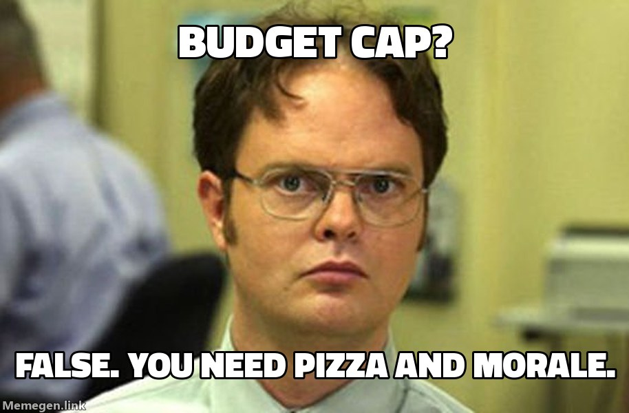
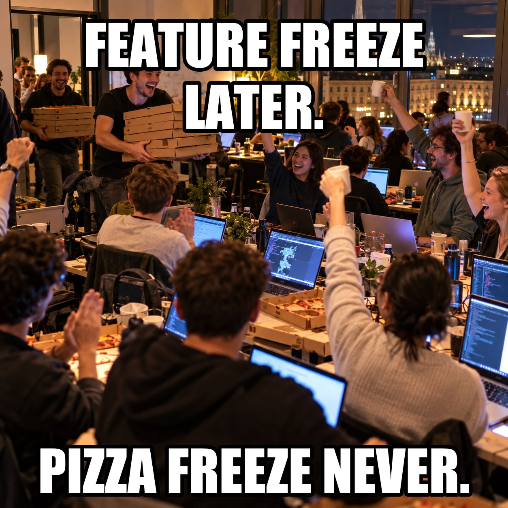
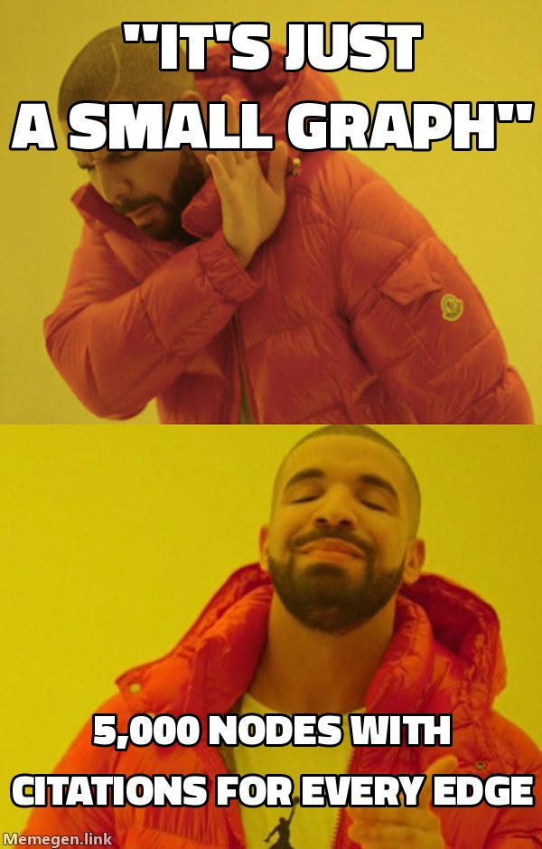
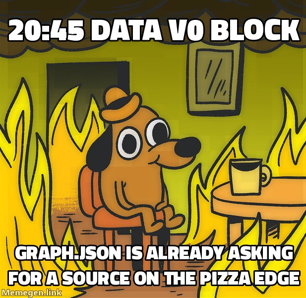

# 🍕 Memes · Hack-Nation Meme-Wettbewerb

Neueste zuerst. **Posten:** Bild runterladen, Oneliner kopieren (Copy-Button rechts am Code-Block), ab in den Discord.
Erstellt mit `05_Memes/meme.py` (lokal) — dieser Ordner wird automatisch überschrieben, hier nichts von Hand ändern.

### Hub organizer: the budget? / let's just increase it. more pizza.


```
Shoutout to our Vienna hub organizers for the most agile budget decision of the weekend 🍕🙌
```

### Hub organizer: the budget? / let's just increase it. more pizza.


```
Budget? Never heard of her. Thank you Vienna hub 🍕❤️
```

### pizza budget


```
The only chart going up and to the right tonight 📈🍕
```

### budget cap? / false. you need pizza and morale.



```
Dwight has reviewed the pizza budget. Dwight approves. 🍕
```

### what if I told you / the real sponsor was extra pizza?


```
Red pill: more pizza. Blue pill: also more pizza. 💊🍕
```

### Stay on budget / Order pizza / Overshoot budget / Increase team velocity


```
Big brain budgeting, Vienna hub edition 🧠🍕
```

### Budget overflow? / Morale deploy successful.


```
Not a bug, a feature: the pizza budget overflowed 🍕🚀
```

### Feature freeze later. / Pizza freeze never.



```
Feature freeze is Sunday noon. Pizza freeze is never. 🍕❄️
```

### "It's just a small graph" / 5,000 nodes with citations for every edge



```
Every hackathon scope estimate ever 📈
```

### 20:45 DATA v0 BLOCK / graph.json is already asking for a source on the pizza edge



```
Status update from the Vienna hub: everything is fine. ☕🔥
```

### 2.8 HOURS IN / THE SCHEDULE SAYS DATA v0. THE TABLE SAYS FINAL BOSS.


```
Hour 3 in Vienna and the table already looks like hour 23 🍕💀
```

---

## 📸 Fotos zum Selbermachen

Foto schießen → an Hanno, der macht die Caption drauf.

- **The roadmap changed. / Pizza became P0.** — Osman hält einen Stapel Pizzakartons wie ein offizielles HackOS-Announcement, Hanno und Recep schauen ernst auf Laptops und nicken. Foto frontal aus leicht tiefer Perspektive, Whiteboard-Zeitplan im Hintergrund.
- **170 judges. / One unanimous decision.** — Alle am Tisch zeigen gleichzeitig auf einen geöffneten Pizzakarton, als wäre er die Gewinner-Demo. Perspektive von oben über Laptops, Kaffeebecher und Kabel hinweg.
- **Vercel can wait. / Pizza is live.** — Hanno sitzt mit Deploy-Screen offen am Laptop, daneben wird ein Pizzakarton dramatisch aufgeklappt. Nahaufnahme seitlich, Bildschirm unscharf, Pizza scharf im Vordergrund.
